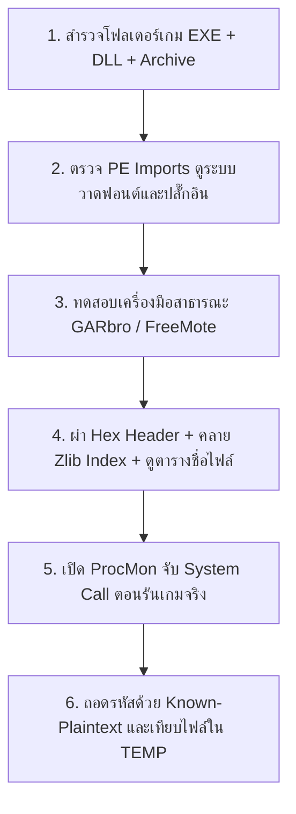
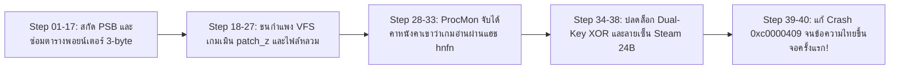
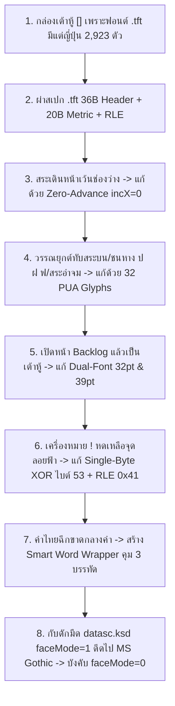
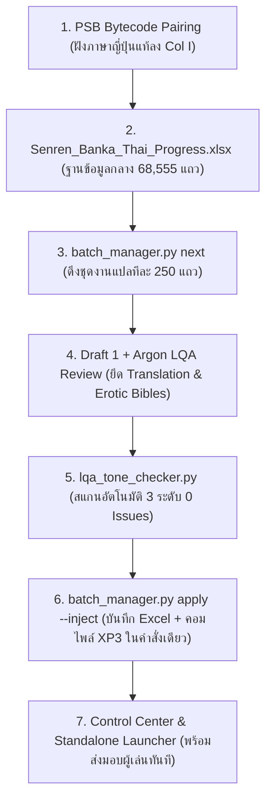

# คัมภีร์แม่แบบวิศวกรรมย้อนกลับและกระบวนการแปลเกม Visual Novel ฉบับสมบูรณ์
## (The Complete Reverse Engineering & Industrial Localization Playbook: From Black-Box Binary to Zero-Defect Release)

> [!IMPORTANT]
> เอกสารฉบับนี้รวบรวม **องค์ความรู้ทั้งหมดตั้งแต่วันแรกจนถึงปัจจุบัน** ของโปรเจกต์แปลไทย **Senren＊Banka (千恋＊万花)** บนเอนจิน Kirikiri Z / FreeMote PSB (Steam 18+ Full Edition — 92 ไฟล์สคริปต์, 68,555 บรรทัด) โดยบันทึกทั้ง **วิธีคิดในการทำวิศวกรรมย้อนกลับ (Reverse Engineering)**, **เส้นทางนรก 40 ขั้นตอนกว่าจะได้เห็นกล่องเต้าหู้ `[]` ครั้งแรกในเกม**, **การผ่าตัดระบบเรนเดอร์ฟอนต์ภาษาไทยทุกชั้น**, **กับดักทางวิศวกรรมที่ซ่อนอยู่ระหว่างแปลทั้งเกม**, ไปจนถึง **สถาปัตยกรรมสายพานการแปลระดับอุตสาหกรรมและตัวติดตั้งสำหรับผู้เล่นปลายทาง** เพื่อใช้เป็นพิมพ์เขียวต้นแบบสำหรับโปรเจกต์แปลเกมถัดไปในอนาคต

---

## สารบัญ (Master Table of Contents)

1. [ปรัชญาและกฎเหล็ก 4 ข้อของการทำม็อดระดับวิศวกรรม](#1-ปรัชญาและกฎเหล็ก-4-ข้อของการทำม็อดระดับวิศวกรรม)
2. [ภาคที่ 1: ระเบียบวิธีวิศวกรรมย้อนกลับเมื่อเริ่มแกะเกมใหม่จากศูนย์ (Reverse Engineering Playbook)](#2-ภาคที่-1-ระเบียบวิธีวิศวกรรมย้อนกลับเมื่อเริ่มแกะเกมใหม่จากศูนย์)
3. [ภาคที่ 2: กว่าจะได้เห็น "กล่องเต้าหู้" ครั้งแรกในเกม — บันทึกเส้นทาง 40 ขั้นตอนแรก](#3-ภาคที่-2-กว่าจะได้เห็น-กล่องเต้าหู้-ครั้งแรกในเกม--บันทึกเส้นทาง-40-ขั้นตอนแรก)
4. [ภาคที่ 3: สงครามการแสดงผลภาษาไทย — ผ่าตัดฟอนต์ `.tft` และกำจัดบั๊กเรนเดอร์ทั้ง 8 ด่าน](#4-ภาคที่-3-สงครามการแสดงผลภาษาไทย--ผ่าตัดฟอนต์-tft-และกำจัดบั๊กเรนเดอร์ทั้ง-8-ด่าน)
5. [ภาคที่ 4: กับดักวิศวกรรมอื่นๆ ที่ซ่อนอยู่เมื่อขยายสเกลสู่ทั้งเกม (92 บท / 18+ DLC)](#5-ภาคที่-4-กับดักวิศวกรรมอื่นๆ-ที่ซ่อนอยู่เมื่อขยายสเกลสู่ทั้งเกม-92-บท--18-dlc)
6. [ภาคที่ 5: สถาปัตยกรรมสายพานการแปลยุคปัจจุบัน, ระบบ LQA อัตโนมัติ และการสร้าง Installer](#6-ภาคที่-5-สถาปัตยกรรมสายพานการแปลยุคปัจจุบัน-ระบบ-lqa-อัตโนมัติ-และการสร้าง-installer)
7. [ภาคที่ 6: พิมพ์เขียว 12 ขั้นตอนสำหรับเริ่มโปรเจกต์เกมถัดไป (Blueprint for Future Games)](#7-ภาคที่-6-พิมพ์เขียว-12-ขั้นตอนสำหรับเริ่มโปรเจกต์เกมถัดไป-blueprint-for-future-games)

---

## 1. ปรัชญาและกฎเหล็ก 4 ข้อของการทำม็อดระดับวิศวกรรม

ก่อนจะแตะไฟล์ไบนารีแม้แต่ไบต์เดียว โปรเจกต์นี้ยึดถือหลักการพื้นฐาน 4 ข้อที่ทำให้เราผ่านวิกฤตทุกครั้งมาได้โดยตัวเกมเสถียร 100%:

1. **Zero EXE / DLL Modification (ไม่ดัดแปลงไฟล์รันหลักและไม่แคร็ก DRM):**
   ห้ามแก้โค้ดเครื่องของ `SenrenBanka.exe` หรือไฟล์ปลั๊กอิน `.dll` เด็ดขาด ม็อดที่ดีต้องทำงานร่วมกับกลไกการโหลดทรัพยากรตามธรรมชาติของเอนจิน (Native Asset Loading) และผ่านการตรวจสอบลิขสิทธิ์ของ Steam ได้อย่างถูกต้อง เพื่อไม่ให้แอนตี้ไวรัสแจ้งเตือน ไม่เสี่ยงแครชข้ามเวอร์ชัน Windows และผู้เล่นปลดล็อก Steam Achievement / Cloud Save ได้ตามปกติ
2. **Sandbox Isolation & External Save Backup (แยกพื้นที่ทดลองเด็ดขาด):**
   ห้ามรันสคริปต์ทดลองใส่โฟลเดอร์เกม Steam โดยตรง ต้องสำรองตัวเกมต้นฉบับบริสุทธิ์ (`archive/original_game_backup/`) และสำรองไฟล์เซฟผู้เล่นทั้งหมด (`backup_user_saves/`) ไว้นอกรัศมีสคริปต์อัตโนมัติตั้งแต่วินาทีแรก
3. **Empirical Tracing over Guessing (พิสูจน์ด้วยหลักฐานระดับ OS/Hex เสมอ):**
   เมื่อเกมไม่อ่านไฟล์หรือเกิดอาการแปลกประหลาด **ห้ามเดาสุ่มซ้ำๆ** ให้ใช้เครื่องมือระดับเคอร์เนลอย่าง **Sysinternals Process Monitor (ProcMon)**, การดัมป์ไฟล์ชั่วคราวใน `%TEMP%`, และการทำ Byte-for-Byte Hex Diff เพื่อดูความจริงว่าเอนจินอ่านไบต์ไหนและถอดรหัสออกมาเป็นค่าอะไร
4. **Clean Unicode Source of Truth (ฐานข้อมูลคำแปลต้องสะอาด 100%):**
   คำแปลในฐานข้อมูลกลาง ([`Senren_Banka_Thai_Progress.xlsx`](../Senren_Banka_Thai_Progress.xlsx)) ต้องเก็บเป็นภาษาไทย Unicode มาตรฐานที่มนุษย์อ่านและแก้ไขได้สะดวก ส่วนการตัดคำและการแปลงรหัสพิเศษ PUA (`U+F700..U+F71F`) ต้องทำในขั้นตอน Compile ไบนารีอัตโนมัติเท่านั้น

---

## 2. ภาคที่ 1: ระเบียบวิธีวิศวกรรมย้อนกลับเมื่อเริ่มแกะเกมใหม่จากศูนย์

เมื่อเปิดโฟลเดอร์ของเกมใหม่ที่เราไม่เคยรู้จักมาก่อน นี่คือลำดับขั้นตอนมาตรฐานในการผ่าโครงสร้างเอนจินอย่างเป็นระบบ:



### ขั้นที่ RE-1: การชันสูตรโครงสร้างไฟล์และ PE Import Table (Initial Triage)
ให้ดูองค์ประกอบ 4 ส่วนในโฟลเดอร์ติดตั้งเกมและระบบปฏิบัติการทันที:
* **ดูตัวรันและปลั๊กอิน (`*.exe`, `plugin/*.dll`):**
  ชื่อ DLL จะบอกสถาปัตยกรรมแทบทั้งหมด เช่น ในเกมนี้พบ:
  * `psbfile.dll` $\rightarrow$ บทพูดไม่ได้เป็น Text ธรรมดา แต่คอมไพล์เป็นไบนารีตระกูล **M2 PSB (Pure Serialization Binary)**
  * `extNagano.dll` $\rightarrow$ ปลั๊กอินถอดรหัสสตรีมและควบคุม Virtual File System (VFS) เฉพาะของค่าย Yuzusoft
  * `krkrsteam.dll` + ไฟล์ `*.xp3.sig` $\rightarrow$ ระบบเชื่อมต่อ Steam API และตรวจลายเซ็นความสมบูรณ์ของคลังข้อมูล
  * `textrender.dll` $\rightarrow$ ตัวจัดวางบรรทัดและวาดตัวอักษรลงหน้าจอ
* **สแกน PE Import Table ของ `.exe` และ `textrender.dll`:**
  ตรวจดูว่าเกมเรียกใช้ไลบรารีจัดเรียงอักษรซับซ้อนหรือไม่:
  * หาก **ไม่มี** `harfbuzz.dll`, `usp10.dll` (Uniscribe), หรือ `dwrite.dll` (DirectWrite) แต่เรียกแค่ `GDI32.dll` (`CreateFontIndirectW`, `GetGlyphOutlineW`) $\rightarrow$ **ฟันธงได้ทันทีตั้งแต่ยังไม่ทันแปลว่า เอนจินนี้ไม่มี Complex Text Layout (CTL)!** หากใส่ภาษาไทยดิบๆ สระและวรรณยุกต์จะลอยหรือทับกันแน่นอน 100% และเราต้องเตรียมระบบ PUA + Zero-Advance ตั้งแต่วันแรก
* **สำรวจคลังข้อมูลและลำดับชื่อ (`*.xp3`):**
  จดรายการคลังข้อมูลทั้งหมดแยกตามหน้าที่ เช่น `data.xp3` (ระบบ/ฟอนต์/UI), `scn.xp3` (สคริปต์ต้นฉบับ), `adult.xp3` (เนื้อหา 18+ เสริม 811 MB), และตระกูลแพตช์ `patch.xp3`, `patch_z.xp3`, `patch_extra.xp3`
* **สำรวจที่เก็บเซฟและคอนฟิกผู้เล่น:**
  เช็กทั้งโฟลเดอร์ `savedata/` ข้างไฟล์ `.exe` และโฟลเดอร์ `%APPDATA%\<ชื่อค่าย>\<ชื่อเกม>\` (เช่น `%APPDATA%\Yuzusoft\SenrenBanka\datasc.ksd` และ `datasu.ksd`) รวมถึง Registry ของ Steam (`HKLM\SOFTWARE\Microsoft\Windows\CurrentVersion\Uninstall\Steam App <AppID>`)

### ขั้นที่ RE-2: ทดลองเจาะด้วยเครื่องมือสาธารณะเพื่ออ่าน "อาการพัง"
ลองเปิดไฟล์คลังข้อมูลด้วยเครื่องมือสำเร็จรูป เช่น **GARbro**, **KrkrExtract**, หรือ **FreeMote**:
* หากเปิดออกได้ทันที $\rightarrow$ ประหยัดเวลาศึกษาโครงสร้างพื้นฐาน
* หากพัง เช่น ฟ้อง `"Corrupted archive header"` หรือแตกไฟล์ออกมาแล้วข้างในเป็นขยะอ่านไม่ออก $\rightarrow$ **อย่าเพิ่งท้อ เพราะอาการพังนั้นคือเบาะแสแรก!** มันแปลว่าผู้พัฒนาดัดแปลง Header Pointer หรือใส่ Stream XOR Filter ครอบทับมาตรฐานเดิมไว้ และเครื่องมือสำเร็จรูปจะไม่สามารถแพ็กไฟล์กลับเข้าเกมให้รันผ่าน DRM ได้ เราต้องเขียน Parser/Repacker ของเราเองด้วย Python

### ขั้นที่ RE-3: การผ่าตัดโครงสร้างคลังข้อมูลระดับไบนารี (Hex & Chunk Forensics)
เปิดไฟล์ `.xp3` ด้วยสคริปต์ Python อ่านไบต์ดิบตั้งแต่หัวไฟล์:
1. **ตรวจ Magic Bytes (Offset `0..10`):** มาตรฐาน Kirikiri คือ `XP3\r\n \n\x1a\x8bg\x01` (11 ไบต์)
2. **แกะกลไก Redirection Pointer 2 ชั้น (จุดที่ทำเครื่องมือทั่วไปพัง):**
   * ใน XP3 มาตรฐาน Offset `11..18` (`uint64 LE`) จะชี้ไปยังดัชนีท้ายไฟล์โดยตรง
   * แต่ในเกม Yuzusoft บน Steam ค่าที่ Offset `11..18` กลับมีค่าเป็น `23`!
   * เมื่อตามไปดูที่ Offset `23` พบแฟล็ก `0x80` (1 ไบต์) + Dummy Length `0` (8 ไบต์) แล้วที่ **Offset `32` (`23 + 9`)** จึงจะเป็นตัวชี้ `real_idx_off` (`uint64 LE`) ที่ชี้ไปยังดัชนีท้ายไฟล์ตัวจริง!
3. **คลายบีบอัด Index และผ่าโครงสร้าง Chunk:**
   * ไปที่ `real_idx_off` อ่านแฟล็ก `0x01` (บีบอัดด้วย Zlib) + `comp_sz` (8B) + `uncomp_sz` (8B) แล้วสั่ง `zlib.decompress()`
   * ไล่อ่าน Tag ทีละก้อน (Magic 4B + Size 8B):
     * **`sen:` Chunk (ขนาด Body 40 ไบต์):** เก็บพิกัดตารางชื่อไฟล์ลับ (`hnfn_off` 8B, `hnfn_uncomp` 4B, `hnfn_comp` 4B) ต่อท้ายด้วย **ลายเซ็น Steam 24 ไบต์** (``\n\x00CSK`\n\xff\x07N\xb1\x82S\x00t\x00e\x00a\x00m\x00\x00\x00``)
     * **`File` Chunks:** เก็บซับชังก์ `info` (แฟล็กเข้ารหัส `0x80000000`, ขนาดไฟล์, ชื่อแฮช MD5 32 ตัว), `segm` (พิกัด `offset` และขนาดข้อมูลในคลัง), `adlr` (ค่าเช็กซัม Adler32 4 ไบต์), และ `time`
     * **ตาราง `hnfn` (Hash Name to File Name):** เมื่อกระโดดไปที่ `hnfn_off` แล้วคลาย Zlib ออกมา จะพบตารางจับคู่ระหว่างค่า **`adlr` (4 ไบต์)** กับ **ชื่อไฟล์จริงแบบ UTF-16LE** (เช่น `0x0F4E317B` $\leftrightarrow$ `001・アーサー王ver1.07.ks.scn` หรือ `0xcfdd73fc` $\leftrightarrow$ `font/font1_32.tft`)!

### ขั้นที่ RE-4: การใช้ Process Monitor (ProcMon) ส่องความจริงระดับ Kernel
เมื่อสงสัยว่าเกมโหลดไฟล์ไหน หรือทำไมวางไฟล์ม็อดแล้วเกมเมิน ให้เปิด **Sysinternals Process Monitor**:
1. ตั้ง Filter: `Process Name` `is` `SenrenBanka.exe`
2. สังเกต Event `CreateFile`, `ReadFile`, `FASTIO_READ`, และ `IRP_MJ_WRITE`:
   * **ดู Path ที่เกมเปิดจริง:** เกมแตะโฟลเดอร์ `font/` หรือ `scn/` บนดิสก์หรือไม่? (ถ้าไม่มีเลยแม้แต่บรรทัดเดียว แปลว่าติดโหมด `TVP_ARCHIVE_ONLY`)
   * **ดู Offset และ Length ที่เกมอ่านใน `.xp3`:** ตัวเลข `Offset` ใน ProcMon สามารถนำไปเทียบกับตาราง `segm` ใน XP3 Index ได้แบบตรงตัว ทำให้รู้ทันที 100% ว่าวินาทีนี้เกมกำลังอ่าน Member ตัวไหนจากคลังใด!
   * **ดูโฟลเดอร์ `%TEMP%`:** Kirikiri Z มักคลายไฟล์ฟอนต์หรือทรัพยากรที่ถอดรหัสแล้วลงใน `%TEMP%\krkr_xxxxxxxx\` ชั่วคราวขณะรันเกม ซึ่งเป็นขุมทรัพย์ในการแกะกุญแจเข้ารหัส!

### ขั้นที่ RE-5: เทคนิคการหากุญแจถอดรหัส (Known-Plaintext Attack & Runtime Temp Diffing)
เราไม่ต้องเสียเวลานั่งไล่ Assembly ที่ซับซ้อนของปลั๊กอินถอดรหัสเลย หากใช้ 2 เทคนิคนี้:

1. **Known-Plaintext Attack บนโครงสร้างหัวไฟล์มาตรฐาน:**
   * **กรณีสคริปต์ PSB (`.ks.scn`):** ไฟล์ PSB แท้ต้องขึ้นต้นด้วย `b"PSB\x00"` เสมอ ดังนั้นกุญแจช่วงแรกหาได้ในบรรทัดเดียว:
     ```python
     k1 = enc_bytes[0] ^ ord('P')  # หรือสแกน 0..255 เช็กว่า version in (2,3) และ header_len == 0x28
     ```
     เมื่อถอด 40 ไบต์แรกด้วย `k1` จะอ่านจุดตัดสตรีม `hdr7 = struct.unpack('<I', head[36:40])[0]` และตำแหน่งตารางสตริง `str_off = hdr[2]` ได้ทันที จากนั้นสแกนหากุญแจช่วงที่สอง (`k2`) โดยเช็กว่าที่ `enc_bytes[str_off] ^ cand` เป็นไบต์บอกขนาด Array ของ PSB (`0x0C..0x0F`) และออฟเซ็ตตัวแรกของ String Pool เป็น `0` เสมอ! (ดูโค้ดจริงในฟังก์ชัน [`decrypt_psb_auto()`](../tools/thai_injector.py#L99-L136))
   * **กรณีฟอนต์ `.tft`:** ไฟล์ฟอนต์พรีเรนเดอร์ของ Kirikiri ต้องขึ้นต้นด้วย `b"TVP pre-rendered font\x1a"` เสมอ ดังนั้น:
     ```python
     k1 = enc_bytes[0] ^ ord('T')  # ord('T') == 0x54
     ```
2. **Runtime `%TEMP%` Keystream Recovery (ไม้ตายปราบกุญแจกลายพันธุ์เฉพาะไบต์):**
   เมื่อเกมรันอยู่แล้วแตกไฟล์ฟอนต์ที่ถอดรหัสเสร็จสมบูรณ์ไว้ใน `%TEMP%\krkr_*\font1_32.tft` ให้นำไฟล์ใน `%TEMP%` (`plain`) มา XOR เทียบกับไบต์ดิบใน `data.xp3` (`enc`) แบบตัวต่อตัวตลอดทั้งไฟล์:
   ```python
   keystream = [plain[i] ^ enc[i] for i in range(len(plain))]
   ```
   วิธีนี้จะเผยทั้งกุญแจช่วงแรก, จุดตัดเปลี่ยนกุญแจ, กุญแจช่วงหลัง **และไบต์กับดักพิเศษ (Single-Byte XOR Anomalies)** ทุกจุดในไฟล์ขนาดนับล้านไบต์ออกมาภายในเสี้ยววินาที!

---

## 3. ภาคที่ 2: กว่าจะได้เห็น "กล่องเต้าหู้" ครั้งแรกในเกม — บันทึกเส้นทาง 40 ขั้นตอนแรก

หลายคนอาจคิดว่ากล่องสี่เหลี่ยมเต้าหู้ (`□□□` หรือ `[]`) คือปัญหา แต่ในความจริงของการทำ Reverse Engineering เกมที่มีระบบป้องกันหลายชั้น **วินาทีที่ได้เห็นกล่องเต้าหู้บนหน้าจอเกมเป็นครั้งแรก คือวินาทีแห่งชัยชนะที่ยิ่งใหญ่ที่สุด** เพราะก่อนหน้านั้นตลอด **39 ขั้นตอนเต็ม (Step 01 – Step 39)** เกมไม่ยอมแสดงข้อความที่เราฉีดเข้าไปเลยแม้แต่ตัวอักษรเดียว!



นี่คือ 5 ด่านนรกที่เราต้องฝ่าฟันกว่าจะไปถึงจุดนั้น (รายละเอียดฉบับเต็มอยู่ใน `lessons_learned/all_reports/`):

### ด่านที่ 1 (Step 01 – Step 17): การผ่าตัด PSB String Pool และบั๊กพอยน์เตอร์เคลื่อน
* **สิ่งที่ทำ:** สกัดข้อความจากสคริปต์บทนำ `001` ออกมาเป็น JSON แล้วสร้างเครื่องมือฉีดภาษาไทยตัวแรก (`psb_injector` v1)
* **ความล้มเหลว:** ใน Step 10A ไฟล์ PSB พังทันทีเพราะคำนวณพอยน์เตอร์ 3-byte Little-Endian ผิด และใน Step 16 พบว่าสคริปต์เผลอเขียนทับ Header ขนาด 4 ไบต์ของ String Offset Table (`0E 3C 0F 0F`) จนโครงสร้างพัง
* **ทางแก้:** พัฒนา `psb_injector_v2.py` ที่คง Object Tree ดั้งเดิมไว้ทุกไบต์ รักษา Header ตารางพอยน์เตอร์ คำนวณออฟเซ็ตใหม่ทั้งหมด และเลื่อนพิกัด Extra Chunks ท้ายไฟล์ จนผ่านสคริปต์ตรวจสอบความสมบูรณ์ครบทั้ง 9 ข้อใน **Step 17**

### ด่านที่ 2 (Step 12 – Step 27): กำแพงล่องหน VFS — ทำไมใส่ม็อดไปกี่วิธี เกมก็ยังเป็นภาษาอังกฤษ?!
เมื่อได้ไฟล์ PSB ที่ถูกต้องสมบูรณ์แบบแล้ว เรานำไปทดสอบรันในเกม แต่ต้องเจอกับ "กำแพงใบ้" ยาวนานถึง 15 ขั้นตอนเต็ม:
1. **แก้สคริปต์ไฟล์หลัก `001・アーサー王ver1.07.ks.scn` (Step 12–15):** เกมเปิดติดปกติ แต่แสดงภาษาอังกฤษเหมือนเดิม! เมื่อแกะ Bytecode ใน Object Tree ที่ Offset `10,205` (Step 23) จึงพบคำสั่ง Opcode `0x15 0x28` สั่ง **กระโดดข้ามไฟล์ (Bytecode Branch)** ไปโหลดไฟล์แยกชื่อ `001・アーサー王ver1.07_en.ks` ทันทีตามการตั้งค่าภาษาใน `multilang.tjs`!
2. **ลองแพ็กใส่ `patch_zz.xp3`, `patch_z.xp3`, และ `patch2.xp3` (Step 18–30):** ตามตำรา Kirikiri ทั่วไป เกมควรโหลดแพตช์เรียงตามตัวอักษร แต่เกมกลับเมินไฟล์เหล่านี้ทั้งหมด!
3. **ลองวางไฟล์หลวม (Loose File) ในโฟลเดอร์ `scn/` (Step 26):** เกมก็ยังเมินสนิท!
* **ความจริงที่ค้นพบ:** เอนจินของ Yuzusoft บังคับโหมด `TVP_ARCHIVE_ONLY` (ไม่อ่านไฟล์นอกคลัง) และใน `Initialize.tjs` มีการล็อกลำดับความสำคัญให้ **`patch_extra.xp3`** อยู่เหนือคลังอื่นทั้งหมด!

### ด่านที่ 3 (Step 28 – Step 33): ปริศนาชื่อไฟล์ล่องหน และการจับผู้ร้ายด้วย ProcMon
* **สิ่งที่ทำ:** เราสร้างสภาพแวดล้อมจำลองแยกขาด (`step28_canary_test`) แล้วลองแพ็กไฟล์ใส่ `patch_extra.xp3` ทั้งในชื่อ `scn/001..._en.ks.scn` และ `001..._en.ks.scn` (Step 31–32) **แต่เกมก็ยังแสดงภาษาอังกฤษเดิม!**
* **จุดเปลี่ยนระดับรากฐาน (Step 33):** เราเลิกเดาชื่อพาธ แล้วเปิด **Process Monitor (ProcMon)** ดักดูทุกไบต์ที่ `SenrenBanka.exe` อ่านจากดิสก์:
  * ProcMon แฉว่าเกมพุ่งไปอ่าน `adult.xp3` ที่ **Offset `99,359,774`** ความยาว `2,429,796` ไบต์!
  * เมื่อเปิดดัชนีเทียบที่ Offset นั้น เราแทบช็อก: ชื่อไฟล์ที่เก็บในคลัง **ไม่ใช่ชื่อสคริปต์** แต่เป็นรหัสแฮช 32 ตัวอักษร **`6ea90065ac5bce797756180572d39b61`**!
  * และใน `patch_extra.xp3` ต้นฉบับ ก็มี Member ชื่อแฮช `6ea90065ac5bce797756180572d39b61` นอนรออยู่ที่ **Offset `950`** เช่นกัน โดยเอนจินใช้ตารางลับ `hnfn` แปลงชื่อสคริปต์เป็นค่าเช็กซัม `Adler32` (`0x0F4E317B`) เพื่อชี้มาหาแฮชนี้!

### ด่านที่ 4 (Step 34 – Step 38): แครช `invalid psb file` และลายเซ็นลับ Steam 24 ไบต์ใน `sen:`
* **แครชแรก (Step 36):** พอเราใส่ไฟล์ PSB ภาษาไทยลงในชื่อแฮช `6ea900...` ที่ Offset `950` ใน `patch_extra.xp3` **เกมยอมอ่านไฟล์ของเราเป็นครั้งแรก!** แต่เด้งกล่อง Error ทันที:
  `001・アーサー王ver1.07.ks.scn: invalid psb file.`
  * **สาเหตุ:** เอนจินมีฟิลเตอร์ XOR อัตโนมัติตอนอ่านสตรีม พอเราส่งไฟล์ Plaintext (`PSB\0`) เข้าไป เอนจินจับ XOR `0x01` กลายเป็น `QRC\x01` หัวไฟล์จึงพังทันที! เราจึงแกะรอยจนค้นพบระบบ **Dual-Key XOR Stream Cipher** (`0x01` สำหรับช่วง `< hdr[7]` และ `0x98` สำหรับช่วง `>= hdr[7]`)
* **การถอยหนีแบบไร้ร่องรอย (Step 38):** พอเราเข้ารหัส Dual-Key XOR ใส่เข้าไป เกมไม่ฟ้อง Error แล้ว... **แต่กลับไปแสดงภาษาอังกฤษเหมือนเดิม!**
  * เปิด ProcMon (`capture_step38.csv`) ดูอีกครั้ง พบว่าเอนจินเปิด `patch_extra.xp3` อ่านเฉพาะ Index ท้ายไฟล์ แล้วปิดทิ้งทันที ก่อนจะหนี (Fallback) ไปอ่าน `adult.xp3`!
  * **ต้นตอ (The Smoking Gun):** สคริปต์สร้างแพตช์ของเราเขียนบล็อก `sen:` ออกมาแค่ **16 ไบต์** (มีแค่พิกัดและขนาด `hnfn`) โดยลืมต่อท้าย **ลายเซ็นดิจิทัล Steam 24 ไบต์** (``\n\x00CSK`\n\xff\x07N\xb1\x82S\x00t\x00e\x00a\x00m\x00\x00\x00``)! ทันทีที่เอนจินเห็นว่า `sen:` มีขนาดไม่ครบ **40 ไบต์** มันถือว่าคลังนี้ไม่ผ่านการรับรองจาก Steam และ **สั่งยกเลิกการโหลดตาราง `hnfn` ทั้งหมดทันที!**

### ด่านที่ 5 (Step 39 – Step 40): แครชจอดำ `0xc0000409` สู่วินาทีประวัติศาสตร์บนหน้าจอเกมจริง!
* **Step 39:** เราประกอบบล็อก `sen:` ครบ 40 ไบต์พร้อมลายเซ็น Steam คราวนี้ ProcMon ยืนยันว่าเกมอ่านข้อมูลที่ Offset `950` ใน `patch_extra.xp3` ครบทุกไบต์ (**Fallback ไป `adult.xp3` = 0 ครั้ง!**) ...แต่เกมกลับ **ค้างหน้าจอดำสนิทแล้วเด้งหลุด (Crash `0xc0000409` ใน `psbfile.dll`)!**
* **การผ่า Disassembly จุดตาย:** เราแกะ `psbfile.dll` ที่ออฟเซ็ต `0x00011ff6` พบคำสั่งโยน Fatal Exception:
  `"psb: undefined object key '%s' is referenced."`
  ความจริงปรากฏทันที: ไฟล์สคริปต์ฐานที่เราใช้ทดสอบมาตั้งแต่ต้นถูกดึงมาจาก `patch_z.xp3` (โครงสร้างสคริปต์ญี่ปุ่น `hdr[7] = 6137`, Object Tree 2.30 MB) แต่ตัวเกม Steam ภาษาอังกฤษต้องการคีย์และ Object Tree ของฝั่งอังกฤษแท้ (`hdr[7] = 2363`, Object Tree 2.21 MB)!
* **Step 40 — ความสำเร็จครั้งแรก:** เราดึงไฟล์ Member `6ea900...` ต้นฉบับแท้จาก `patch_extra.xp3` ของ Steam ออกมาถอดรหัส ฉีดคำแปลไทยแบบ In-Place โดยรักษา Object Tree 2,211,330 ไบต์ไว้ครบ 100% เข้ารหัส Dual-Key XOR ที่จุดตัด `2363` และแพ็กพร้อม `sen:` 40 ไบต์...
  **วินาทีที่กดเริ่มเกม หน้าจอดำหายไป กล่องข้อความปรากฏขึ้น พร้อมข้อความภาษาไทยชุดแรกในประวัติศาสตร์บนเอนจินแท้ของเกม!** และเมื่อเริ่มใส่ประโยคภาษาไทยเต็มรูปแบบ เราก็ได้เผชิญหน้ากับ **"กองทัพกล่องเต้าหู้ `[]` และสระวรรณยุกต์ลอยเคว้งคว้าง"** ซึ่งนำไปสู่มหากาพย์ภาคที่ 3!

---

## 4. ภาคที่ 3: สงครามการแสดงผลภาษาไทย — ผ่าตัดฟอนต์ `.tft` และกำจัดบั๊กเรนเดอร์ทั้ง 8 ด่าน

เมื่อข้อความภาษาไทยเข้าไปอยู่ในหน่วยความจำของเกมได้แล้ว ทำไมมันถึงกลายเป็นกล่องเต้าหู้ `[][][]` หรือแยกชิ้นส่วนเป็น `ท ี ' `? นี่คือปัญหาการแสดงผลทั้ง **8 ด่าน** ที่เราเจอตามลำดับเวลา และวิธีแก้ระดับไบนารีของแต่ละด่าน:



### ด่านแสดงผลที่ 1: ต้นตอของ "กล่องเต้าหู้ `[]`" (Pre-rendered `.tft` Cache)
* **ปัญหา:** วางไฟล์ฟอนต์ `.ttf` ในโฟลเดอร์เกม หรือสั่งแก้ชื่อฟอนต์ในสคริปต์แล้วไม่มีผล ตัวอักษรไทย (หรือรหัสพิเศษ) กลายเป็นกล่องสี่เหลี่ยม `[]`
* **สาเหตุ:** เกมของ Yuzusoft ไม่ได้ใช้ฟอนต์เวกเตอร์ `.ttf` วาดสดในโหมดปกติ แต่ใช้ไฟล์บิตแมปสำเร็จรูป **TVP Pre-rendered Font (`.tft`)** ที่ฝังอยู่ใน `data.xp3` ซึ่งเรนเดอร์ตัวอักษรญี่ปุ่นและอังกฤษเตรียมไว้แค่ **2,923 ตัว** ไม่มีรหัสภาษาไทย (`U+0E01..U+0E5B`) เลยแม้แต่ตัวเดียว!
* **วิธีแก้:** ต้องผ่าโครงสร้างไบนารีของ `.tft` เพื่อสร้างเครื่องมือขยายฟอนต์ ([`tool/build_both_extended_fonts.py`](../tools/build_all_extended_fonts.py)) ที่วาดภาพพิกเซลภาษาไทยเพิ่มเข้าไปต่อท้ายตารางเดิม!

### ด่านแสดงผลที่ 2: การแกะสเปกไบนารี `.tft` และการวาดเกรย์สเกล 64 ระดับ
จากการแกะไบนารีของ `font1_32.tft` โครงสร้างไฟล์ประกอบด้วย 4 ส่วนเป๊ะๆ:
1. **Header (36 ไบต์):**
   * `0..21` (22B): Magic `b"TVP pre-rendered font\x1a"`
   * `22` (1B): Version (`0x01`), `23` (1B): Unicode Flag (`0x02` / UTF-16)
   * `24..27` (`uint32`): จำนวนตัวอักษรรวม (`total_count`)
   * `28..31` (`uint32`): พิกัดตารางรหัสตัวอักษร (`ch_index_off`)
   * `32..35` (`uint32`): พิกัดตารางเมทริกซ์ (`metric_index_off`)
2. **Compressed Glyph Bitmaps (เริ่มที่ไบต์ 36):** ก้อนพิกเซลเกรย์สเกลค่าความสว่าง `0..64` ที่บีบอัดแบบ RLE
3. **Character Index Table:** อาร์เรย์ของรหัส Unicode `uint16` เรียงจากน้อยไปมาก (**สำคัญมาก: ต้อง Sort รหัสจากน้อยไปมากเสมอ เพราะเอนจินค้นหาตัวอักษรด้วย Binary Search!**)
4. **Metric Records (20 ไบต์ต่อตัวอักษร — `struct.pack('<IHhhhhhhH', ...)`):**
   เก็บค่า `(glyph_offset, width, height, origin_x, origin_y, inc_x, inc_y, inc, reserved)`
* เราใช้ `ctypes` เรียก Windows GDI `GetGlyphOutlineW` ในโหมด `GGO_GRAY8_BITMAP` เพื่อแปลงฟอนต์ `Noto Sans Thai Looped` ออกมาเป็นพิกเซลเกรย์สเกล `0..64` ที่คมกริบระดับเดียวกับฟอนต์แท้ของญี่ปุ่น

### ด่านแสดงผลที่ 3: กับดักสระเดินหน้า (`ท ี ่`) และการปฏิวัติด้วย Zero-Advance (`incX = 0`)
* **ปัญหา:** พอใส่ตัวอักษรไทยลงใน `.tft` กล่องเต้าหู้หายไป แต่คำว่า `"ที่นี่"` กลับแสดงผลแยกเป็น `"ท ี ่ น ี ่"` มีช่องว่างแทรกทุกครั้งที่มีสระบน สระล่าง หรือวรรณยุกต์!
* **สาเหตุ:** เอนจิน `textrender.dll` คำนวณตำแหน่งตัวอักษรถัดไปด้วยสมการเส้นตรงแบบญี่ปุ่น:
  $$\text{Cursor}_{X, n+1} = \text{Cursor}_{X, n} + \text{incX}(\text{char}_n) + \text{pitch}$$
  เอนจินไม่รู้จัก Combining Marks พอกล่องอักษรของสระอิมีค่าความกว้าง `gmCellIncX > 0` เคอร์เซอร์จึงขยับหนีไปทางขวาทุกครั้ง!
* **วิธีแก้:** สำหรับสระลอย สระจม และวรรณยุกต์ไทยทั้ง 17 ตัว (`0x0E31`, `0x0E34..0x0E3A`, `0x0E47..0x0E4E`) เราบังคับเขียนทับค่าใน Metric Record 20 ไบต์เป็น:
  ```python
  g['incX'] = 0
  g['incY'] = 0
  g['inc']  = 0
  ```
  ทันทีที่ `incX = 0` เคอร์เซอร์จะหยุดรออยู่ที่พยัญชนะฐาน ทำให้สระและวรรณยุกต์ตกลงบนแกนกลางของพยัญชนะพอดีเป๊ะ!

### ด่านแสดงผลที่ 4: วรรณยุกต์ทับสระบน, ชนหาง `ป ฝ ฟ ฬ`, ชนเชิง `ญ ฐ` และสระอำจม (`น้ำ`) $\rightarrow$ ระบบ Thai PUA Shaper 32 พิกัด
ลำพัง `incX = 0` แก้ได้แค่สระชั้นเดียว แต่ภาษาไทยมี **4 ระดับแนวดิ่ง** เมื่อเอนจินไม่มี OpenType GPOS/GSUB รหัสไม้เอกตัวเดียว (`U+0E48`) ไม่สามารถมีพิกัด $(X, Y)$ หลายจุดพร้อมกันได้ เราจึงสร้าง **Glyph พิเศษ 32 ตัวในย่าน Private Use Area (`U+F700 .. U+F71F`)** ฝังลงในฟอนต์ `.tft` คู่กับสคริปต์แปลงข้อความอัตโนมัติ [`tool/thai_pua_shaper.py`](../tools/thai_pua_shaper.py):

| ช่วงรหัส PUA | บทบาททางอักขรศิลป์ | การปรับพิกัดเทียบกับ Glyph มาตรฐาน |
| :--- | :--- | :--- |
| **`U+F700`, `U+F70F`** | **`ฐ` และ `ญ` แบบตัดเชิงล่าง** | ตัดแถวพิกเซลใต้เส้นบรรทัด (`crop_h = oy`) ออก เพื่อไม่ให้ทับสระ `ุ / ู` (เช่น `ผู้หญิง`, `ฐาน`) |
| **`U+F701 .. U+F704`** | **สระบน (`ิ ี ึ ื`) เยื้องซ้าย** | `ox = ox - shift_left` (`-5px` / `-6px`) หลบหางพยัญชนะสูง `ป ฝ ฟ ฬ` |
| **`U+F710 .. U+F712`** | **`ั`, `ํ`, `็` เยื้องซ้าย** | `ox = ox - shift_left` สำหรับวางบน `ป ฝ ฟ ฬ` |
| **`U+F705 .. U+F709`** | **วรรณยุกต์ (`่ ้ ๊ ๋ ์`) ระดับต่ำ-เยื้องซ้าย** | `ox = ox - shift_left` เมื่อวางบน `ป ฝ ฟ ฬ` โดยตรง **หรือเมื่อมีสระล่างคั่น** (เช่น `ปู่`, `ปู้`, `ฝุ่น` — ต้องเช็กย้อนไปที่ `out[-2]`!) |
| **`U+F70A .. U+F70E`** | **วรรณยุกต์ระดับปกติ** | พิกัดมาตรฐานสำหรับพยัญชนะทั่วไป |
| **`U+F713 .. U+F717`** | **วรรณยุกต์ระดับสูง (High Tone)** | `oy = oy + elevate_tone` (`+8px` / `+10px`) ยกลอยขึ้นชั้น 3 เหนือสระบน (`ที่`, `ขึ้น`, `ดื่ม`) |
| **`U+F718 .. U+F71A`** | **สระล่าง (`ุ ู ฺ`) เลื่อนต่ำพิเศษ** | `oy = oy - shift_left` หลบหางล่างของ `ฎ ฏ ฤ` |
| **`U+F71B .. U+F71F`** | **วรรณยุกต์ระดับสูง-เยื้องซ้าย (High-Left)** | `ox - shift_left` **และ** `oy + elevate_tone` สำหรับพยัญชนะหางยาวที่มีทั้งสระบนและวรรณยุกต์ซ้อนกัน (`ปี้`, `ฟื้น`, `ฝิ่น`)! |

* **การแก้สระอำ (`น้ำ`, `ช้ำ`) และการพิมพ์ผิดลำดับ (Pass 1 Normalization):**
  ใน `thai_pua_shaper.py` ก่อนทำ PUA Mapping จะมี Pass 1 คอยสลับลำดับกรณีคนพิมพ์วรรณยุกต์ก่อนสระ และ **แยกสระอำ (`\u0E33`) ที่มีวรรณยุกต์** ออกเป็น 3 ชิ้น: `นิคหิต (\u0E4D)` + `วรรณยุกต์ (ซึ่งจะถูกยกเป็น High Tone อัตโนมัติใน Pass 2)` + `สระอา (\u0E32)` ทำให้ไม้โทลอยเด่นเหนือวงกลมสระอำอย่างงดงาม ไม่จมทับกันอีกต่อไป!

### ด่านแสดงผลที่ 5: บั๊กเปิดหน้า Backlog แล้วกลายเป็นเต้าหู้ `[]` (Dual-Font Subsystem)
* **ปัญหา:** หน้ากล่องบทพูดหลักแสดงภาษาไทยสวยกริบ แต่พอกดเลื่อนเมาส์ขึ้นดูประวัติย้อนหลัง (**Backlog / History**) ตัวอักษรกลับกลายเป็นเต้าหู้ `[]` ทั้งหน้า!
* **สาเหตุ:** แกะสคริปต์ `sysscn/MyHistoryLayer.tjs` และตาราง `hnfn` พบว่าเกมแยกใช้ฟอนต์คนละไฟล์ตามขนาดเลเยอร์:
  * **หน้าบทสนทนาหลัก:** ใช้ `font/font1_32.tft` (Member 8 ใน `data.xp3`, ขนาดเรนเดอร์ `-36px`, กุญแจ XOR `0x54` / `0x56` ตัดที่ไบต์ `2154`)
  * **หน้า Backlog:** ใช้ `font/font1_39.tft` (Member 9 ใน `data.xp3`, ขนาดเรนเดอร์ `-44px`, กุญแจ XOR `0x43` / `0x4C` ตัดที่ไบต์ `2134`)
* **วิธีแก้:** สร้างและฉีดฟอนต์ขยายทั้ง 2 ขนาดเข้าสู่ Member 8 และ Member 9 ของ `data.xp3` พร้อมกัน ([`inject_both_fonts_data_xp3.py`](../tools/inject_all_fonts_data_xp3.py)) โดยเลื่อนออฟเซ็ตของไฟล์ที่ 10 ถึง 1,277 ไปข้างหน้าตามค่า $\Delta_{\text{total}}$ และ **คงค่า `adlr` เดิมของฟอนต์ทั้งสอง (`0xcfdd73fc` และ `0x9fe15f6a`) ไว้ในดัชนี** เพื่อให้ตาราง `hnfn` จับคู่ชื่อฟอนต์เจอทันทีโดยไม่ต้องรื้อตารางแฮช!

### ด่านแสดงผลที่ 6: ปริศนาเครื่องหมายตกใจ (`!`) หดเหลือจุดลอยบนเพดาน, กฎ RLE `0x41` และตัว `ว` มีเส้นใต้
นี่คือบั๊กที่ลึกลับและน่าทึ่งที่สุดของทั้งโปรเจกต์:
1. **เหตุการณ์ `!` กลายเป็นจุดลอยฟ้า:** เมื่อเราเปลี่ยนไปดึงเครื่องหมาย `!` (`0x21`) จากฟอนต์ `Leelawadee UI Semibold` เพื่อให้ก้านกับจุดไม่ติดกัน พอเข้าเกมจริง ก้านและจุดล่างหายเกลี้ยง เหลือแค่จุดจิ๋วลอยติดเพดานบรรทัด (`มาซาโอมิ อึ๊ดดดด˙`)!
2. **การผ่าพิกเซลพิสูจน์ความจริง:** เรานำไฟล์ `font1_32.tft` ที่เอนจินคลายออกมาใน `%TEMP%\krkr_*` มาทำ Hex Diff เทียบกับไฟล์ที่เราสร้าง พบว่าจาก **1,418,609 ไบต์ มีไบต์เพี้ยนไปเพียง 3 ไบต์เท่านั้น!** (ที่ออฟเซ็ต `53`, `32158`, และ `60494` สำหรับฟอนต์ 32pt และที่ออฟเซ็ต `25420`, `65365` สำหรับฟอนต์ 39pt)
   * บังเอิญอย่างเหลือเชื่อที่ **ออฟเซ็ต `53`** คือไบต์เริ่มต้นแถวที่ 4 ของตัว `!` พอดี!
   * เราเข้ารหัสไบต์นั้นด้วย `0x54` ($56 \oplus \text{0x54} = 110$) แต่ฟิลเตอร์ถอดรหัสของ Yuzusoft มี **Single-Byte Salt Anomaly** ที่ไบต์ `53` โดยใช้กุญแจ **`0xAC`** ถอดรหัส!
   * ผลลัพธ์: $110 \oplus \text{0xAC} = 192$ (`0xC0`) ซึ่งในระบบ RLE ของ `.tft` ไบต์ `0xC0` แปลว่า **"จงก๊อปปี้พิกเซลก่อนหน้า (ซึ่งคือเลข `0` โปร่งใส) ซ้ำไปอีก $192 - 64 = 128$ พิกเซล!"** ก้านและจุดล่างทั้ง 22 แถวจึงถูกถมด้วยสีล่องหนหายวับไปในพริบตา!
   * **วิธีแก้:** อัปเดตฟังก์ชันเข้ารหัสให้ใช้กุญแจตรงตามจุด Salt ทุกจุด (`53 -> 0xAC`, `32158 -> 0x94`, `60494 -> 0xEA` สำหรับ Member 8 และ `25420 -> 0x19`, `65365 -> 0x2F` สำหรับ Member 9) จนถอดรหัสออกมาตรงกัน **100% Bit-for-Bit**!
3. **กฎเหล็ก Kirikiri RLE ห้ามปล่อยไบต์ `0x41`:** คอมเพรสเซอร์ RLE ต้องไม่ปล่อยโค้ด `0x41` (สั่งซ้ำ 1 ครั้ง) ออกมาเด็ดขาด หากเจอพิกเซลสีเดียวกันติดกัน 2 ตัว (`run_len == 2`) ต้องเขียนค่าสีนั้นซ้ำ 2 ไบต์แบบ Literal เสมอ มิฉะนั้นตัวอ่าน C++ ของเกมจะดีโค้ดสตรีมพิกเซลเหลื่อมตำแหน่ง
4. **Multi-Font Hybrid แก้ตัว `ว` มีขีดเส้นใต้:** ฟอนต์ `Noto Sans Thai Looped` มีห่วงล่างของตัว `ว` (`0x0E27`) แบนกว้าง พอเอนจินเกมวาดเส้นขอบสีดำ (Outline Stroke) รอบตัวอักษร จึงดูเหมือนตัว `ว` มีขีดเส้นใต้ตลอดเวลา เราแก้โดยเขียนข้อยกเว้นใน `build_both_extended_fonts.py` ให้สลับไปดึงเฉพาะตัว `ว` จากฟอนต์ **`Tahoma`** และดึง `!` กับ `?` จาก **`Leelawadee UI Semibold`** ผสมเข้าเป็นฟอนต์ลูกผสมที่สมบูรณ์แบบทุกตัวอักษร!

### ด่านแสดงผลที่ 7: ระบบตัดคำอัจฉริยะป้องกันคำฉีกและล้นกล่อง 3 บรรทัด (`thai_word_wrapper.py`)
* **ปัญหา:** ภาษาไทยเขียนติดกันโดยไม่เว้นวรรค เอนจินจะตัดบรรทัดตรงขอบจอแบบดื้อๆ ทำให้คำฉีกขาดน่าเกลียด (เช่น `มุราซา|เมะมารุ`, `เจ้า|ค่ะ?`) ครั้นจะใส่ `\n` บังคับขึ้นบรรทัดใหม่ เอนจิน KAG ก็แครช `start.ks:43 Syntax error` ทันที!
* **วิธีแก้:** สร้าง [`tool/thai_word_wrapper.py`](../tools/thai_word_wrapper.py) ใช้ `PyThaiNLP (newmm)` ร่วมกับคลังคำเฉพาะจาก `glossary.json`:
  * นับความยาวสายตา (`visual_length`) โดย **ไม่นับสระบน-ล่าง วรรณยุกต์ และรหัส PUA ที่มีความกว้างเป็นศูนย์**
  * เคารพการเว้นวรรคตามธรรมชาติของผู้แปล 100% และตัดเฉพาะก้อนที่ยาวเกิน `max_vis=56` ด้วยระบบให้คะแนนไวยากรณ์ (ห้ามตัดหน้า `ๆ, ค่ะ, นะคะ, ?, !` เด็ดขาด และให้น้ำหนักจุดตัดหน้าคำเชื่อม `แต่, เพราะ, เพื่อ, หรือ`)
  * มีตัวจำลอง `_simulate_kag_lines(box_vis=58)` เช็กว่าข้อความจะล้นเกินเพดาน 3 บรรทัดของกล่องข้อความหรือไม่ หากเกินจะบีบระยะตัดคำลงเป็น `max_vis=38` อัตโนมัติ

### ด่านแสดงผลที่ 8: กับดักมืดตัวสุดท้าย — `datasc.ksd` (`faceMode = 1` / MS Gothic Fallback)
* **อาการหลอน:** หลังจากฟอนต์และแพตช์สมบูรณ์ 100% แล้ว วันหนึ่งเมื่อเปิดเล่นจริงในเครื่องผู้เล่น กลับเจอกล่องเต้าหู้โผล่เฉพาะตรงสระซ้อน (`ที[]`, `เมื[]อ`, `ตั[]ง`) และตัวอักษรเคาะห่าง (`เล ่า`, `มั น`, `ผู ้`) ทั้งที่เช็กไฟล์ `.xp3` แล้วถูกต้องทุกไบต์!
* **ต้นตอที่แท้จริง ([Case Study 08](case_studies/08_CASE_STUDY_DATASC_FACEMODE_AND_INSTALLER_SPECS.md)):**
  ในไฟล์ตั้งค่าระบบของผู้เล่น `%APPDATA%\Yuzusoft\SenrenBanka\datasc.ksd` มีตัวแปรชื่อ `"faceMode"`:
  * `"faceMode" => 0` = บังคับใช้ฟอนต์พรีเรนเดอร์ `.tft` ของเกม (ที่เราฝังฟอนต์ไทย + PUA ไว้)
  * `"faceMode" => 1` = **ข้ามไฟล์ `.tft` ทั้งหมด** แล้วสั่ง Windows GDI ให้ไปดึงฟอนต์ระบบชื่อ `"スキップ"` (Fontworks Skip) ซึ่งเครื่องคนไทยไม่มีฟอนต์นี้ Windows จึงเตะ Fallback ไปหาฟอนต์ญี่ปุ่นโบราณ **`MS Gothic`**!
  * `MS Gothic` ไม่มีรหัส Thai PUA (`U+F700..U+F71F`) จึงวาดเป็นกล่องเต้าหู้ `[]` และมองสระไทยเป็นตัวอักษรความกว้างเต็มช่อง!
* **วิธีแก้ถาวร:** ผ่าโครงสร้างไฟล์ `.ksd` (Header 21 ไบต์: Magic `\xfe\xfe\x02\xff\xfe` + `<QQ` ขนาดบีบอัดและขนาดจริง + ก้อน Zlib ของข้อความ UTF-16LE) สร้างฟังก์ชัน `fix_facemode_setting()` ฝังไว้ในทุก Launcher และ Installer เพื่อเปลี่ยน `"faceMode" => 1,` ให้เป็น `"faceMode" => 0,` อัตโนมัติทุกครั้งก่อนเริ่มเกม!

---

## 5. ภาคที่ 4: กับดักวิศวกรรมอื่นๆ ที่ซ่อนอยู่เมื่อขยายสเกลสู่ทั้งเกม (92 บท / 18+ DLC)

เมื่อก้าวจากการทำ Proof-of-Concept บทแรก ไปสู่การแปลและทดสอบจริงครบ **92 ไฟล์สคริปต์ (68,555 บรรทัด)** ของเวอร์ชัน 18+ Uncensored เราได้เจอกับดักระดับลึกอีก **9 เรื่อง** ที่คนทำม็อดเกมถัดไปต้องรู้ล่วงหน้า:

### 1. วิกฤตเซฟเกม 75 สล็อตหายเกลี้ยง & อาการ Auto-Skip พุ่งทะลุช้อยส์
* **เซฟหาย ([Case Study 01](case_studies/01_CASE_STUDY_SAVE_GAME_LOSS.md)):** Kirikiri Z ผูกพาธโฟลเดอร์ `savedata/` เข้ากับ **Current Working Directory (CWD)** ตอนสั่งรันโปรเซส พอสั่งรันข้ามโฟลเดอร์จำลอง เกมจึงสร้างโฟลเดอร์เซฟว่างเปล่า และทำ Steam Cloud สับสนซ่อนเซฟเดิมทั้งหมด!
  * *กฎป้องกัน:* สคริปต์ `.bat` หรือ Launcher ทุกตัวต้องสั่ง `cd /d "%~dp0"` (หรือกำหนด `cwd=game_dir` ใน `subprocess.Popen`) เสมอ และต้องสำรอง `savedata/` (รวมถึงไฟล์ไบนารี `savecheck` 44 ไบต์) ไว้นอกโฟลเดอร์ทำงาน
* **Auto-Skip ทะลุเนื้อเรื่อง:** ผู้เล่นที่เคยเล่นจบไปแล้ว ไฟล์ `datasc.ksd` จะเปิด `enterSkipOnReadedLabel = 1` คู่กับบันทึกฉากที่เคยอ่านแล้วใน `datasu.ksd` ทำให้พอกดเริ่มเกมปุ๊บ เกมกรอข้ามบทแปลไทยทั้งหมดพุ่งไปจอดที่ Choice แรกทันที! แก้โดยปรับแฟล็ก Skip ใน `datasc.ksd` หรือกดปิด Skip All/Read ในตั้งค่าเกม (และหากแก้ไฟล์เซฟ ต้องอัปเดต SHA-1 ใน `remotecache.vdf` ของ Steam ด้วย)

### 2. อันตรายของ NTFS Hard-link (`st_nlink > 1`) และดิสก์บวม 160 GB
* **Hard-link Hazard ([Case Study 07](case_studies/07_CASE_STUDY_NTFS_HARDLINK_HAZARD.md)):** ตอนโคลนคลังเกม 10 GB ไปยังโฟลเดอร์ทดสอบด้วย Hard-link (`os.link`) การเปิดไฟล์แก้แบบ `r+b` จะทะลุไปแก้ Inode เดียวกันในโฟลเดอร์ต้นฉบับด้วย!
  * *กฎเหล็ก:* ทุกครั้งที่เขียนไฟล์ `.xp3` หรือ `.xlsx` ต้องเขียนลงไฟล์ใหม่ `.tmp`/`.new` แล้วสั่ง `os.remove(target)` ตามด้วย `os.rename(temp, target)` (Unlink & Atomic Replace) เสมอ
* **Storage Lifecycle ([Case Study 09](case_studies/09_CASE_STUDY_STORAGE_REFACTORING_AND_ASSET_LIFECYCLE.md)):** การโคลน `.xp3` ทดสอบ 13 โฟลเดอร์ทำให้โปรเจกต์บวมถึง **159.89 GB** เมื่อวิจัยจบต้องเก็บเฉพาะโค้ดและ Log ไว้เป็นหลักฐาน แล้วลบ `.xp3` ซ้ำซ้อนในโฟลเดอร์ทดลองเก่า (คืนพื้นที่ได้ถึง **137.95 GB**)

### 3. บั๊กมรณะ `start.ks:43 Syntax error` และอักขระพิษของ KAG Parser
* **สาเหตุ ([Case Study 02](case_studies/02_CASE_STUDY_KAG_SYNTAX_ERROR.md)):** ในเอนจิน KAG คำสั่งแท็ก `[text val="..."]` ใช้การขึ้นบรรทัดใหม่เป็นตัวจบคำสั่ง หากผู้แปลเผลอกด `Alt+Enter` ใน Excel จนมี `\n` หรือ `\r` หลุดเข้าไปในสตริง หรือมี ASCII Single Quote (`'`) ไปกวน TJS Parser เกมจะแครชเด้ง `start.ks:43 Syntax error (タグ:不明)` ทันที!
* **วิธีแก้:** ฟังก์ชัน `sanitize_text()` ใน [`thai_injector.py`](../tools/thai_injector.py#L81-L97) กวาดล้าง `\r\n`, `\n`, `\r` เป็นช่องว่าง, แปลง `'` เป็น `’`, ลบวงเล็บญี่ปุ่น `「」『』` (เพราะเอนจินเติมกรอบคำพูดให้อัตโนมัติอยู่แล้ว), และลบช่องว่างที่หลุดไปคั่นหน้าสระลอย/PUA ทุกครั้งก่อนแพ็ก

### 4. เนื้อหา 18+ แยกคลัง (`patch_extra.xp3` มีแค่ 25 บท vs `adult.xp3` 811 MB มี 67 บท)
* **ปัญหาใหญ่:** ตัว `patch_extra.xp3` มาตรฐานบน Steam มีสคริปต์แค่ 25 บทแรก (แถมเป็นเวอร์ชันตัดฉากเรต เช่น บท `002` ฉากบ่อน้ำพุร้อน) ส่วนสคริปต์รูทนางเอกเต็มรูปแบบและฉาก 18+ อีก **67 บท** ซ่อนอยู่ในไฟล์ยักษ์ `adult.xp3` ขนาด 811 MB! หากเราต้องแพ็ก `adult.xp3` ใหม่ทุกครั้งที่แปล จะช้ามากและไฟล์ม็อดแจกจ่ายจะใหญ่เกือบ 1 GB!
* **นวัตกรรม Adult Archive Harvester ([`thai_injector.py` บรรทัด 610–736](../tools/thai_injector.py#L610-L736)):**
  อาศัยความจริงที่ว่า **`patch_extra.xp3` มีลำดับ VFS Priority สูงกว่า `adult.xp3`**! ตัว `thai_injector.py` จึงเปิดอ่านสคริปต์ 18+ ดิบจาก `adult.xp3` เฉพาะบทที่แปลแล้ว นำมาถอดรหัส ฉีดภาษาไทย เข้ารหัสกลับด้วยคีย์เดิมของไฟล์นั้น แล้ว **นำก้อนไบนารีไปต่อท้ายใน `patch_extra.xp3`** พร้อม **สังเคราะห์ระเบียน `hnfn` ใหม่ (`b'hnfn'` + `adlr` + ชื่อไฟล์ UTF-16LE)** เพิ่มเข้าไปในตารางชื่อไฟล์ของ `patch_extra.xp3`!
  * *ผลลัพธ์:* ไม่ต้องแตะต้อง `adult.xp3` ของผู้เล่นแม้แต่ไบต์เดียว คอมไพล์ทั้งเกมเสร็จใน ~12 วินาที และไฟล์ม็อดมีขนาดกะทัดรัดเพียง ~100 MB!

### 5. เพดานพอยน์เตอร์ PSB 64 KB แตก (`0xFFFF` String Pool Overflow)
* **ปัญหา:** ตัวอักษรอังกฤษ ASCII ใช้ 1 ไบต์ต่อตัว แต่ภาษาไทย UTF-8 และรหัส PUA ใช้ **3 ไบต์ต่อตัวอักษร**! ในบทที่มีบทพูดยาวมาก ตารางเดิมของไฟล์ต้นฉบับเก็บพอยน์เตอร์แบบ **2 ไบต์ (`entry_type = 0x0E`, สูงสุด 65,535 ไบต์)** พอฉีดภาษาไทยเข้าไป ขนาด String Pool พุ่งทะลุ 65,535 ไบต์ ทำให้ `int.to_bytes(2, 'little')` Overflow พังทันที!
* **วิธีแก้ ([`thai_injector.py` บรรทัด 378–405](../tools/thai_injector.py#L378-L405)):** สร้างระบบ **Dynamic Offset Width Promotion** เช็กค่า `max_offset` ของ String Pool ใหม่:
  * ถ้า `<= 0xFFFF` ใช้ `out_width = 2` (`0x0E`)
  * ถ้า `<= 0xFFFFFF` อัปเกรดตารางเป็น `out_width = 3` (`0x0F`) อัตโนมัติ!
  * ถ้าเกิน `0xFFFFFF` อัปเกรดเป็น `out_width = 4` (`0x10`)
  พร้อมคำนวณผลต่างความยาวตารางที่เปลี่ยนไป แล้วอัปเดตพอยน์เตอร์หลักทั้ง 4 ตัวใน PSB Header (`str_data`, `extra_off`, `extra_data`, `extra_end` ที่ไบต์ `20, 24, 28, 32`) อย่างแม่นยำ!

### 6. กับดักชื่อไฟล์มีเลขเวอร์ชัน (`ver1.07`) และบทย่อยรีเซ็ตบรรทัด (`508a` / `508b`)
* ชื่อไฟล์อย่าง `002・プロローグ２ver1.07.ks.scn` หากใช้ Regex ดึงตัวเลขทั้งหมด (`\d+`) จะได้เลขบทเป็น `002107` แทนที่จะเป็น `002`! ต้องบังคับจับเฉพาะตัวเลขต้นชื่อไฟล์ด้วย `re.match(r'^(\d+)([a-z]?)', base_name, re.I)` เท่านั้น
* ใน Extra Routes บท `508` มี 2 ไฟล์ย่อย (`508a` และ `508b`) ที่เลขบรรทัดเริ่มนับ 1 ใหม่กลางชีต ต้องแยก รหัสบทให้ชัดเจนเพื่อไม่ให้ตัวจับคู่สตริงทับกัน

### 7. ปัญหาสตริงสั้นใช้ร่วมกันข้ามเพศใน String Pool (Shared Short-String Collision)
* **การค้นพบตอนเล่นจริง:** คอมไพเลอร์ PSB จะยุบรวมสตริงภาษาอังกฤษที่เขียนเหมือนกันเป๊ะในบทเดียวกันให้เหลือแค่ 1 รายการใน String Pool (Deduplication)! เช่นใน Common Route สตริงหมายเลข `#371` คำว่า `"I will."` ถูกชี้ไปใช้ทั้งตอน **โยชิโนะ** ตอบรับคุณพ่อ (`「はい」`) และตอน **มาซาโอมิ (พระเอก)** รับปากมุราซาเมะ (`「責任、取るよ……」`)! พอแปลเป็น `"เข้าใจแล้วค่ะ"` พระเอกจึงพูด `"ค่ะ"` กลางเกมทันที!
* **กฎเหล็ก:** คำพูดสั้นๆ 1–3 คำที่เป็นคำทั่วไป (`Yes.`, `I will.`, `Right.`, `Got it.`, `Okay.`) **ต้องแปลแบบไม่ระบุเพศ (Gender-Neutral)** เสมอ เช่น `"เข้าใจแล้ว"`, `"ตกลง"`, `"อื้ม"` ยกเว้นเช็กแล้วว่าถูกเรียกใช้แค่จุดเดียวในไฟล์นั้น

### 8. ปัญหาประโยคคู่แฝด 2 เวอร์ชัน (Display vs. Backlog Variant Desync)
* **อาการ:** บทพูดที่มีการตะโกนพร้อมกันหลายตัวละคร หรือมีแท็กควบคุมความเร็วข้อความ (เช่น `%123;Sorry, no!`, `120\%`, หรือ `"Worcestershire sauce!"\n"Soy sauce!"`) ใน String Pool จะมีสตริงเก็บแยกกัน **2 ตัว**: ตัวหนึ่งมีแท็กสำหรับวาดขึ้นหน้าจอสด (Display) และอีกตัวเป็นข้อความคลีนสำหรับแสดงในหน้าประวัติย้อนหลัง (Backlog) พอใน Excel มีแค่ตัวเดียว อีกหน้าหนึ่งจึงหลุดเป็นภาษาอังกฤษ!
* **วิธีแก้:** สร้าง **Pass 4 Sibling Variant Sync** (`canon_variant()` + `encode_for_pool_entry()` ใน [`thai_injector.py`](../tools/thai_injector.py#L251-L326)) ปอกแท็ก `%XX;` และ `\%` ออกเพื่อเทียบแกนข้อความเดียวกัน แล้วฉีดคำแปลไทยเข้าทั้งสองสตริงพร้อมกัน โดยคงแท็ก `%XX;` นำหน้าและจังหวะขึ้นบรรทัดของตัว Display ไว้ครบถ้วน!

### 9. ชื่อผู้พูด, ตัวเลือกช้อยส์ (EN + JP Fallback Keys) และเสียงเอฟเฟกต์เอนจิน
* ชื่อตัวละครบนกล่องชื่อ (Speaker Names กว่า 160 รูปแบบ รวมถึงชื่อคู่ เช่น `"Yoshino, Mako, Lena"`), ตัวเลือกการตัดสินใจเข้าแต่ละรูท (รวมถึงช้อยส์ในฉาก 18+ ซึ่งบางบทเช็กจากคีย์ญี่ปุ่นดิบ เช่น `"中に出す"` / `"外に出す"`), และเสียงประกอบบนจอ 28 รายการ (`*squish*`, `*slurp*`) ถูกเก็บแยกจากแถวบทสนทนาปกติ จึงต้องรวมศูนย์ไว้ใน [`tool/patch_names_and_choices.py`](../tools/patch_names_and_choices.py) เพื่อกวาดแปลทั่วทั้ง String Pool ของทุกบทอัตโนมัติ

---

## 6. ภาคที่ 5: สถาปัตยกรรมสายพานการแปลยุคปัจจุบัน, ระบบ LQA อัตโนมัติ และการสร้าง Installer

เมื่อแก้ปัญหาเอนจินครบทุกจุดแล้ว โจทย์ถัดมาคือ **"ทำอย่างไรให้แปลและเกลาบทพูดกว่า 68,555 บรรทัด ได้เร็ว งานไม่ค้าง สำนวนระดับมืออาชีพ และตัวละครไม่หลุดคาแรกเตอร์แม้แต่บรรทัดเดียว?"** นี่คือระบบสายพานการผลิตที่พัฒนาจนสมบูรณ์ในปัจจุบัน:



### 1. การทลาย "กับดักแปลเพี้ยนจากภาษาอังกฤษ" ด้วยการสกัดภาษาญี่ปุ่นจาก Bytecode ลง Column I
* ในช่วงแรกที่แปลจากภาษาอังกฤษ (Column E) เพียงอย่างเดียว เราพบ **English Localization Distortion** จำนวนมาก เช่น:
  * `玉子焼き` อังกฤษแปลเป็น `"omelet"` (ไข่เจียว) ทั้งที่จริงคือ **`ไข่ม้วน`**
  * `ネギ` อังกฤษแปลเป็น `"onion"` (หัวหอม) ทั้งที่จริงคือ **`ต้นหอม`**
  * `祖父` อังกฤษใช้ `"Grandpa"` คำเดียว ทำให้สับสนระหว่างปู่กับตา! เมื่อเช็กต้นฉบับญี่ปุ่น เก็นจูโร่คือพ่อของแม่มาซาโอมิ จึงต้องเรียกว่า **`คุณตา`** (ในขณะที่โคฮารุและเร็นทาโร่เรียก **`คุณปู่`**)
  * น้ำเสียงเฉพาะตัว เช่น มุราซาเมะพูดสำเนียงโบราณ (`〜じゃ`, `〜であろう`), เลน่าหลุดมุกซามูไรเฉพาะตอนพูด `〜であります` / `御意` (ไม่ได้พูดเจ้าค่ะ/ขอรับพร่ำเพรื่อทุกประโยค)
* **ทางแก้ระดับวิศวกรรม (`tool/argon_bridge.py` & `tool/populate_all_japanese.py`):**
  เราเขียนตัวสแกน Bytecode ใน Object Tree ของ `.ks.scn` จับคู่ออปโค้ดดัชนีสตริงที่อยู่ติดกันภายในหน้าต่าง 22 ไบต์ (`0x15` 1-byte, `0x16` 2-byte, `0x17` 3-byte) เพื่อดึง **ประโยคภาษาญี่ปุ่นต้นฉบับแท้** มาฝังลงใน **Column I** ของไฟล์ [`Senren_Banka_Thai_Progress.xlsx`](../Senren_Banka_Thai_Progress.xlsx) สำเร็จถึง **67,832 / 68,555 แถว (98.95% ของทั้งเกม)**! นับแต่นั้นมา การแปลทุกบรรทัดยึด **ภาษาญี่ปุ่น (Col I) เป็นความจริงสูงสุด** และใช้ภาษาอังกฤษ (Col E) เป็นเพียงตัวช่วยเช็กบริบท

### 2. กฎเหล็ก Single-Pass Zero-Freeze Pipeline (ขจัดปัญหา Excel ล็อกไฟล์และค้าง 40 วินาที)
* การเปิดไฟล์ Excel ขนาด 7.5 MB (68,555 แถว) ด้วย `openpyxl` ใช้เวลา Parse XML นาน 15–35 วินาที และหากผู้แปลเปิดโปรแกรม Excel ค้างไว้ Windows จะล็อกไฟล์จนเกิด `PermissionError`
* เราจึงสร้าง `tool/batch_manager.py` ภายใต้กฎ `.agents/rules/single_pass_pipeline.md`:
  1. **Shadow Temp-Copy Read:** ทุกครั้งที่อ่าน Excel (ทั้งใน Injector, Batch Manager และ GUI) จะก๊อปปี้ไฟล์ไปยัง `%TEMP%` ด้วยชื่อเฉพาะของ PID ก่อนเสมอ ทำให้ดึงข้อมูลได้แม้เปิด Excel ทิ้งไว้!
  2. **Single-Pass Write + Inject:** คำสั่ง `python tool/batch_manager.py apply --file ... --inject` จะบันทึกคำแปล อัปเดตสถิติด้วยสูตร Excel แท้ (`=COUNTIFS`, `=SUMIF` ผ่าน `tool/sync_overview_sheet.py`) เขียนสลับไฟล์แบบ Atomic Replace และยิงเข้า `thai_injector.py` รวดเดียวจบโดยห้ามรันสคริปต์เปิดอ่าน Excel ซ้ำซ้อนอีก

### 3. คัมภีร์มาตรฐานการแปลคู่ขนาน & เครื่องสแกน LQA อัตโนมัติ 3 ระดับ (`lqa_tone_checker.py`)
เพื่อคุมคุณภาพงานแปลระดับหมื่นบรรทัดให้เหมือนออกจากปลายปากกานักแปลคนเดียวทั้งเกม เราใช้ระบบ 2 ประสาน:
* **คัมภีร์ควบคุมสำนวน:**
  * [`MASTER_TRANSLATION_BIBLE.md`](../localization/database/MASTER_TRANSLATION_BIBLE.md): กำหนด **Character Voice Matrix** ตายตัว เช่น มาซาโอมิ (บทบรรยายใช้ `ผม` ห้ามมี `ครับ`, บทพูดปกติ `ผม/ครับ`, ฉากรักลึกซึ้งเปลี่ยนเป็น `ฉัน/เธอ`), มุราซาเมะ (`ข้า / นายท่าน / เจ้า` + หางเสียงโบราณ `หนา, รึ, เล่า, ดอก, เถิด` ห้ามหลุด `ค่ะ/คะ/หรอ` และห้ามซ้อน `นะหนา` ส่วนตอนเป็นจิตในดาบต้องใส่เครื่องหมาย `“...”`), โยชิโนะ (`ฉัน` + `ค่ะ/นะคะ`), มาโกะ (`ดิฉัน/ฉัน` + `ค่ะ/เจ้าค่ะ`), เลน่า (`ฉัน` + `ค่ะ/นะคะ` ใช้ `ขอรับ!` เฉพาะมุกทหาร)
  * `EROTIC_TRANSLATION_BIBLE.md`: สำหรับฉาก 18+ แบนคำศัพท์การแพทย์แข็งทื่อ (`องคชาต`, `ช่องคลอด`), แบนคำหยาบโลน, และแบนสำนวนนิยายเก่าชวนเลี่ยน (`ถึงฝั่งฝัน`, `แก่นกาย`, `แท่งหยก`, `ร่องสวาท`, หรือการใช้ `ความเป็นชาย` ซ้ำซาก) โดยใช้ระบบหมุนเวียนคำศัพท์ 3 ระดับและละคำนามซ้ำตามธรรมชาติภาษาไทย (Zero-Anaphora)
* **เครื่องตรวจจับอัตโนมัติ (`tool/lqa_tone_checker.py`):**
  สแกนทั้งรูทหมื่นกว่าบรรทัดเสร็จในไม่กี่วินาที แบ่งเป็น 3 ชั้น:
  * **Tier 1 (Engine & Formatting):** จับ `\n` ดิบ, วงเล็บ `「」『』` ตกค้าง, เครื่องหมาย `“...”` เปิด-ปิดไม่ครบคู่, ตัวอักษรญี่ปุ่นคานะ/`ー`/`ッ` หลุดรอด, บทพูดภาษาอังกฤษตกหล่น
  * **Tier 2 (Lexicon & H-Scene Safety):** ใช้ Regex Word-Boundary ตรวจคำต้องห้ามโดยไม่เกิด False Positive กับคำปกติ (เช่น แยกคำหยาบออกจากคำว่า `คอหอย`, `หอยเม่น`, `พุ่งสูงปรี๊ด` ได้แม่นยำ)
  * **Tier 3 (Character Persona DNA):** ตรวจจับทันทีหากมุราซาเมะเผลอพูด `ค่ะ`, มาซาโอมิเผลอพูด `เจ้าค่ะ`, บทบรรยายหลุด `ครับ`, หรือตัวละครเรียกสรรพนามผิดคน!

### 4. ระบบ GUI ศูนย์บัญชาการ และแพ็กเกจตัวติดตั้งสำหรับผู้เล่นทั่วไป (Release Ecosystem)
โปรเจกต์แยกเครื่องมือสำหรับ **"ผู้พัฒนา/นักแปล"** กับ **"ผู้เล่นปลายทาง"** ออกจากกันอย่างชัดเจน:
* **สำหรับทีมแปล (`SenrenBanka_ControlCenter.py`):**
  แอปพลิเคชัน Desktop GUI ธีมมืด (Tkinter แบบไม่ต้องลงไลบรารีเสริม) แสดงหลอดความคืบหน้าทุกรูทและทุกบทแบบสดๆ มีปุ่ม 1-Click ฉีดแพตช์พร้อมจอดู Log เรียลไทม์, ปุ่มดึง Batch ถัดไป, ปุ่มส่งออกไฟล์ตรวจทาน `DELTA_REVIEW_FOR_ARGON.md`, ปุ่มรัน `lqa_tone_checker.py`, และระบบสำรองเซฟเกม
* **สำหรับผู้เล่นทั่วไป (`tool/SenrenBanka_Thai_Launcher.py` $\rightarrow$ `SenrenBanka_Thai_Launcher.exe` & `Install_Thai_Mod.bat`):**
  คอมไพล์ด้วย PyInstaller เป็น `.exe` ไฟล์เดียวพร้อมใช้งานคู่กับชุดติดตั้งอัตโนมัติ ทำหน้าที่สำคัญครบวงจร:
  1. ค้นหาโฟลเดอร์ติดตั้งเกมอัตโนมัติผ่าน Windows Registry ของ Steam (`Steam App 1144400`) และพาธมาตรฐาน
  2. ติดตั้ง `patch_extra.xp3` และโฟลเดอร์สำรอง `font/` (`font1_32.tft`, `font1_39.tft`)
  3. **ซ่อมค่า `faceMode = 0` ใน `%APPDATA%\Yuzusoft\SenrenBanka\datasc.ksd` แบบเงียบๆ ทุกครั้งก่อนเปิดเกม** เพื่อการันตี 100% ว่าผู้เล่นทุกคนจะไม่เจอบั๊กกล่องเต้าหู้จาก `MS Gothic`!
  4. มีปุ่มสลับโหมด **เล่นภาษาไทย** $\leftrightarrow$ **เล่นภาษาอังกฤษ/ญี่ปุ่นดั้งเดิม** ได้ในคลิกเดียว (ด้วยการสลับชื่อ `patch_extra.xp3` $\leftrightarrow$ `patch_extra.xp3.disabled` โดยไม่ทำลายไฟล์ต้นฉบับ)

---

## 7. ภาคที่ 6: พิมพ์เขียว 12 ขั้นตอนสำหรับเริ่มโปรเจกต์เกมถัดไป (Blueprint for Future Games)

เมื่อคุณจะเริ่มต้นแปลเกมถัดไป (ไม่ว่าจะเป็นเกมค่าย Yuzusoft อย่าง *Sanoba Witch, Riddle Joker, Cafe Stella, Tenshi Souzou Re-Boot!* หรือวิชวลโนเวลเอนจินอื่น) ให้เดินตาม **Master Checklist 12 ขั้นตอนนี้ตามลำดับ** จะช่วยย่นเวลาลองผิดลองถูกจากหลายสัปดาห์ให้เหลือเพียงไม่กี่ชั่วโมง:

| ลำดับ | ขั้นตอนปฏิบัติการ (Phase) | สิ่งที่ต้องทำและจุดเช็กพอยต์สำคัญ | เครื่องมือต้นแบบจากโปรเจกต์นี้ที่นำไปต่อยอดได้ทันที |
| :---: | :--- | :--- | :--- |
| **01** | **Backup & Sandbox Setup** | สำรองโฟลเดอร์เกมสะอาดไว้ใน `archive/original_game_backup/` และสำรองเซฟผู้เล่นทั้งหมด (`savedata/` + `%APPDATA%`) แยกโฟลเดอร์รันทดสอบที่มี `cd /d "%~dp0"` | `Start_Thai_Game.bat`, กฎ Atomic File Replace (ห้ามแก้ผ่าน Hard-link) |
| **02** | **Engine & Font CTL Audit** | ส่องไฟล์ `.exe`, `plugin/*.dll` และ PE Imports ดูว่าใช้เอนจินอะไร (Kirikiri Z / Unity / ArtemiS / Siglus / LucaSystem / BGI) และมีตัวจัดสระ (HarfBuzz / DirectWrite) หรือไม่ | หากไม่มี CTL เตรียมใช้ระบบ PUA + Zero-Advance ทันที |
| **03** | **VFS Priority & ProcMon Trace** | เปิด ProcMon ดูตอนเกมบูตเข้าฉากแรก: เกมยอมอ่านไฟล์หลวมนอกคลังไหม? ลำดับคลังไหนสูงสุด (`patch_extra` / `update` / `patch`)? เกมแตกแคชฟอนต์ลง `%TEMP%` ไหม? | วิธีวิเคราะห์ `IRP_MJ_READ` Offset เทียบตาราง Archive Index |
| **04** | **Archive Index & DRM Unlock** | ผ่า Header คลังข้อมูล เช็ก Redirection Pointer (เช่น Offset 11 $\rightarrow$ 23 $\rightarrow$ 32), ตารางแฮชชื่อไฟล์ (`hnfn` + `adlr`), และบล็อกลายเซ็น DRM (เช่น `sen:` 40 ไบต์) | [`method/02_XP3_ARCHIVE_SPEC_AND_INJECTION.md`](02_XP3_ARCHIVE_SPEC_AND_INJECTION.md), `read_xp3_scenarios()` |
| **05** | **Cryptanalysis & Keystream Dump** | หาคีย์ถอดรหัสสคริปต์และฟอนต์ด้วย Known-Plaintext (`PSB\0`, `TVP pre-rendered font\x1a`) **และทำ Byte-by-Byte XOR เทียบกับไฟล์ใน `%TEMP%`** เพื่อหาจุด Salt พิเศษทุกไบต์ | `decrypt_psb_auto()` ใน [`tool/thai_injector.py`](../tools/thai_injector.py), [`inject_both_fonts_data_xp3.py`](../tools/inject_all_fonts_data_xp3.py) |
| **06** | **Canary Test (ล่ากล่องเต้าหู้แรก)** | ฉีดสตริงทดสอบ `"THAI TEST กขค"` ลงในประโยคแรกของสคริปต์แท้ (รักษา Object Tree เดิม 100%) แพ็กกลับพร้อมลายเซ็น DRM แล้วเปิดเกมเช็กว่าข้อความขึ้นจอและไม่แครช | การทดสอบ Canary 1 ประโยคก่อนทำระบบใหญ่ |
| **07** | **Font Engineering (32pt + Backlog)** | ค้นหาไฟล์ฟอนต์ **ทุกขนาด** ที่เกมใช้จริง (หน้าบทพูดหลัก, Backlog, ชื่อตัวละคร, ช้อยส์) ขยายอักขระไทย + `incX=0` + 32 PUA (`U+F700..U+F71F`) + ตรวจ RLE และบังคับคอนฟิกเกมไม่ให้ดีดไปใช้ `MS Gothic` (`faceMode = 0`) | [`tool/build_both_extended_fonts.py`](../tools/build_all_extended_fonts.py), [`tool/thai_pua_shaper.py`](../tools/thai_pua_shaper.py), `fix_facemode_setting()` |
| **08** | **Full Dry-Run Stress Test** | เขียนสคริปต์รันทดสอบถอดรหัส $\rightarrow$ จำลองขยาย String Pool เกิน 64 KB $\rightarrow$ เข้ารหัสกลับ **ครบทุกไฟล์ในเกม (รวมไฟล์ 18+ DLC)** จนผ่าน 100% โดยไม่มี Error | โหมด `--test-all-92` และ Dynamic Offset Width Promotion (`2->3->4B`) ใน [`tool/thai_injector.py`](../tools/thai_injector.py) |
| **09** | **Bilingual Master DB Construction** | สกัดบทพูดทั้งเกม (รวมเนื้อหา 18+ Uncensored) สร้างสเปรดชีตกลางที่มี **ภาษาญี่ปุ่นต้นฉบับคู่กับภาษาอังกฤษ** พร้อมดึงรายชื่อ Speaker, Choices, และ SFX แยกไว้ครบถ้วน | `tool/rebuild_excel_18plus_full.py`, `tool/argon_bridge.py`, [`tool/patch_names_and_choices.py`](../tools/patch_names_and_choices.py) |
| **10** | **Translation & Erotic Bibles** | กำหนดคลังคำศัพท์ (`glossary.json`), ตารางสรรพนาม-หางเสียงของทุกตัวละคร (Voice Matrix), กฎคำสั้นไร้เพศ, และมาตรฐานคำศัพท์ฉาก 18+ ก่อนเริ่มแปลจริง | [`MASTER_TRANSLATION_BIBLE.md`](../localization/database/MASTER_TRANSLATION_BIBLE.md), `EROTIC_TRANSLATION_BIBLE.md` |
| **11** | **Single-Pass Pipeline & Auto LQA** | แปลทีละ Batch (200–250 บรรทัด) ผ่านระบบตัดคำอัตโนมัติ สแกนด้วย LQA Checker 3 ระดับจนเป็น 0 Issues และตรวจสอบทั้งหน้าพูดปกติ + หน้า Backlog เป็นระยะ | `tool/batch_manager.py`, [`tool/thai_word_wrapper.py`](../tools/thai_word_wrapper.py), `tool/lqa_tone_checker.py` |
| **12** | **End-User Launcher & Packaging** | สร้างตัวติดตั้งและ Launcher แบบ `.exe` ไฟล์เดียวที่หาพาธ Steam อัตโนมัติ, แอบแก้คอนฟิกฟอนต์ใน `%APPDATA%` เงียบๆ, และสลับภาษาเปิด-ปิดม็อดได้ในคลิกเดียว | `SenrenBanka_ControlCenter.py`, `tool/SenrenBanka_Thai_Launcher.py` |

### หมายเหตุเพิ่มเติมเมื่อเจอเกมที่ใช้เอนจินตระกูลอื่นในอนาคต
* **เกมค่าย Yuzusoft อื่นๆ (Kirikiri Z + PSB):** โครงสร้าง `XP3 Offset 23/32`, `sen:` 40B, `hnfn`, `.ks.scn` Dual-Key XOR, `.tft` Pre-rendered Font และ `datasc.ksd` (`faceMode`) **เหมือนกันแทบจะ 100%** เปลี่ยนแค่ค่าคงที่กุญแจ XOR และตำแหน่ง Member ของฟอนต์ซึ่งสคริปต์ของเราสแกนหาอัตโนมัติได้ทันที!
* **Kirikiri 2 / Kirikiri Z ค่ายทั่วไป (สคริปต์ `.ks` เป็น Text UTF-16LE / UTF-8):** ไม่ต้องแกะ PSB String Pool แต่ต้องระวังเรื่อง KAG Tags (`[r]`, `[l]`, `[p]`, `@nm`) และถ้าเกมใช้ฟอนต์ `.ttf` ผ่าน `GDI32` โดยตรงแต่ไม่มี HarfBuzz ก็ยังสามารถใช้ **`thai_pua_shaper.py` คู่กับฟอนต์ `.ttf` ที่ฝังตาราง PUA (`U+F700..U+F71F`)** ได้ด้วยหลักการเดียวกันเป๊ะ!
* **Unity (IL2CPP / Mono + TextMeshPro / UGUI):** ฟอนต์มักเก็บเป็น **TMP Font Asset (SDF Atlas)** ใน AssetBundles / Addressables การแก้เต้าหู้คือสร้าง SDF Atlas ภาษาไทยด้วย Unity Editor เวอร์ชันตรงกับเกม ส่วนปัญหาสระลอยหากตัวเกมไม่เปิด OpenType Mark-to-Base ใน TMP ก็สามารถนำโมดูล **`thai_pua_shaper.py` และ `thai_word_wrapper.py`** ของโปรเจกต์นี้ไปใช้แปลงข้อความก่อนแพ็กเข้า AssetBundle ได้ทันทีเช่นกัน!
* **เอนจินญี่ปุ่นเฉพาะค่ายอื่นๆ (SiglusEngine, CatSystem2, BGI/Ethornell, ArtemiS, LucaSystem):** หัวใจสำคัญยังคงเหมือนเดิม 100% คือ: **(1) ใช้ ProcMon ดูการอ่านคลังและไฟล์ชั่วคราว**, **(2) เช็กว่าเอนจินวาดตัวหนังสือจาก GDI สดหรือ Bitmap Atlas ล่วงหน้า**, **(3) ใช้ `incX=0` + `PUA U+F700..U+F71F` ปราบสระลอยเมื่อเอนจินไม่มี CTL**, และ **(4) ใช้ฐานข้อมูลสองภาษา (JP+EN) คู่กับ LQA Scanner เพื่อคุมคุณภาพงานแปล**

---

> [!TIP]
> **สรุปแก่นแท้ที่มีค่าที่สุดจากโปรเจกต์นี้:**
> ทุกอุปสรรคที่ดูเหมือน "เป็นไปไม่ได้" ในตอนแรก—ตั้งแต่คลังไฟล์ที่เครื่องมือโลกเปิดไม่ออก, สคริปต์ที่ใส่แล้วเกมเมินเฉย 30 กว่ารอบ, แครชจอดำไร้ข้อความ, กองทัพกล่องเต้าหู้, สระกระเด็นห่าง, วรรณยุกต์ทับกัน, เครื่องหมายตกใจหดเหลือจุดเดียวเพราะไบต์ที่ 53 เพี้ยนไปไบต์เดียวในล้านไบต์, ไปจนถึงคอนฟิกมืดใน `%APPDATA%`—ล้วนถูกพิชิตได้เพราะ **"เราไม่เคยเดาสุ่มซ้ำที่เดิม แต่ลงไปอ่านความจริงระดับไบนารีและเคอร์เนลเสมอ"** ความรู้และชุดเครื่องมือทั้งหมดในโฟลเดอร์ `method/`, `lessons_learned/` และ `tool/` คืออาวุธสำเร็จรูปที่พร้อมพาคุณพิชิตเกมถัดไปได้อย่างมั่นใจตั้งแต่วันแรกครับ!
