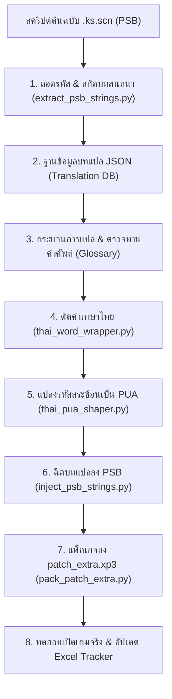

# 05. กระบวนการแปลแบบ Batch และการควบคุมคุณภาพ (Workflow & Batch Translation)

เอกสารนี้ระเบียบวิธีการทำงาน (Workflow) ตั้งแต่การสกัดข้อความ, การแบ่งชุดแปล (Batch Strategy), การตัดคำภาษาไทย, ไปจนถึงการแพตช์และตรวจสอบความคืบหน้า

---

## 1. แผนภาพกระบวนการทำงานแบบครบวงจร (End-to-End Pipeline)



---

## 2. กลยุทธ์การแปลแบบแบ่งส่วน (Batch Translation Strategy)

เกมวิชวลโนเวลของ Yuzusoft มีบทพูดยาวกว่า 40,000 - 60,000 บรรทัด การพยายามแปลทั้งหมดรวดเดียวจะทำให้:
- ไม่สามารถทดสอบข้อผิดพลาดในเกมจริงได้จนกว่าจะเสร็จ
- เสี่ยงต่อการพบว่าฟอนต์หรือสคริปต์พังหลังจากแปลไปแล้วหลายพันบรรทัด

### แนวทางปฏิบัติที่ดีที่สุด (Best Practice):
1. **แบ่งเป็นบท (Chapter) และกลุ่มย่อย (Batch):**
   - เช่น บทนำ (Prologue) มี 1,227 บรรทัด แบ่งออกเป็น 8 บัตช์ย่อย (บัตช์ละ 100-150 บรรทัด)
   - ตัวอย่าง **Batch 1.1:** 149 บรรทัดแรก ตั้งแต่เปิดเกมจนถึงพระเอกแยกกับคนขับแท็กซี่
2. **สร้าง Checkpoint ที่เล่นได้ทันที (Playable Checkpoint):**
   - ทุกครั้งที่แปลเสร็จหนึ่งบัตช์ ให้ฉีดเข้า `patch_extra.xp3` และส่งมอบตัวเกมที่เล่นได้ทันที เพื่อให้ตรวจสอบความลื่นไหลของบทและฟอนต์ทางสายตา

---

## 3. การตัดคำภาษาไทย (Thai Word Wrapping)

ภาษาไทยไม่มีการเว้นวรรคระหว่างคำ หากพิมพ์ข้อความยาวต่อเนื่อง ตัวเอนจินเกมจะตัดบรรทัดเมื่อตัวอักษรชนขอบจอ ส่งผลให้**คำฉีกกลางคำ** (เช่น `สถา|นี`, `กระ|โดด`):

* **แนวทางแก้ไข:**
  1. ใช้พจนานุกรมตัดคำภาษาไทย (เช่น PyThaiKey หรือ PyMultiDictionary) ตรวจสอบความยาวพิกเซลของแต่ละบรรทัด
  2. แทรกช่องว่างแคบ หรือขึ้นบรรทัดใหม่ด้วยวรรคธรรมชาติเมื่อถึงความกว้างประมาณ 40-50 ตัวอักษร
  3. **ข้อห้ามสำคัญ:** ต้องไม่แทรกตัวอักษร `\n` แบบดิบลงในสตริงบทพูด ให้ใช้การแบ่งวรรคเพื่อป้องกัน Syntax Error ของเอนจิน

---

## 4. ระบบฐานข้อมูลและการบันทึกความคืบหน้า (Progress Tracker)

### ก. โครงสร้างข้อมูล JSON (`translation_db.json`)
```json
{
  "file": "001・アーサー王ver1.07.ks.scn",
  "total_lines": 149,
  "entries": [
    {
      "index": 0,
      "speaker": "Taxi Driver",
      "original_en": "Sir.",
      "thai_text": "คุณลูกค้าครับ",
      "status": "translated"
    },
    {
      "index": 1,
      "speaker": "Masaomi",
      "original_en": "...Hm?",
      "thai_text": "...หือ?",
      "status": "translated"
    }
  ]
}
```

### ข. การบันทึกความคืบหน้าด้วย Excel (`Senren_Banka_Thai_Progress.xlsx`)
สร้างสเปรดชีตติดตามความคืบหน้า 2 แผ่นงานหลัก:
1. **ภาพรวมความคืบหน้า:** สรุปเปอร์เซ็นต์รวมของเกม แยกตามรูท (Prologue, Yoshino, Mako, Murasame, Lena, Sub-routes)
2. **แผนการแปลแต่ละรูท:** แสดงสถานะของแต่ละไฟล์, จำนวนบรรทัดที่แปลแล้ว, วันที่อัปเดต และบันทึกหมายเหตุ
