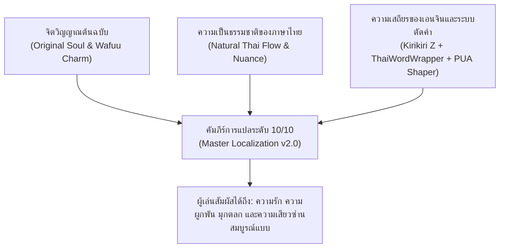
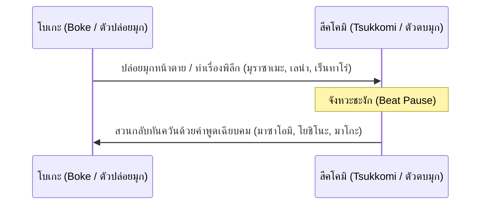

# ⛩️ SENREN＊BANKA — MASTER TRANSLATION BIBLE (v2.0)
## คัมภีร์และมาตรฐานการแปลเกม 千恋＊万花 ฉบับสมบูรณ์ครอบคลุมทั้งเกมและระบบเอนจิน
### (Comprehensive Localization Standard, Cultural Lexicon, Engine Constraints & Design Rationale)

> **เกม:** Senren＊Banka (千恋＊万花) — Yuzusoft (Steam 18+ Uncensored Full Edition)  
> **ฐานข้อมูลรองรับ:** 68,555 แถว (92 Scenarios: 25 ใน `patch_extra.xp3` + 67 ใน `adult.xp3` / 6 รูทเนื้อเรื่อง)  
> **ไฟล์เป้าหมาย:** `localization/database/MASTER_TRANSLATION_BIBLE.md`  
> **สถานะ:** กฎบัตรหลักสูตรมาตรฐานสูงสุดสำหรับนักแปล ระบบตัดคำ `ThaiWordWrapper` และระบบตรวจทาน LQA ทั้งหมดในโปรเจกต์  

---

## สารบัญ (Table of Contents)
1. [ปรัชญาและวิสัยทัศน์สูงสุดในการแปล (Core Philosophy & Vision)](#1-ปรัชญาและวิสัยทัศน์สูงสุดในการแปล-core-philosophy--vision)
2. [คู่มือน้ำเสียง อัตลักษณ์ตัวละคร และตารางพัฒนาการคำเรียกขาน (Comprehensive Character Personas & Dynamic Addressing)](#2-คู่มือน้ำเสียง-อัตลักษณ์ตัวละคร-และตารางพัฒนาการคำเรียกขาน-comprehensive-character-personas--dynamic-addressing)
3. [อภิธานศัพท์ชินโต-ประวัติศาสตร์ และกับดักสคริปต์ภาษาอังกฤษ (Lore, Shinto Lexicon & Anti-English Traps)](#3-อภิธานศัพท์ชินโต-ประวัติศาสตร์-และกับดักสคริปต์ภาษาอังกฤษ-lore-shinto-lexicon--anti-english-traps)
4. [ศิลปะการแปลมุกตลกและจังหวะตบมุก (Comedy, Boke & Tsukkomi Dynamics)](#4-ศิลปะการแปลมุกตลกและจังหวะตบมุก-comedy-boke--tsukkomi-dynamics)
5. [ศิลปะการแปลฉากต่อสู้ พิธีกรรม และไสยเวทชินโต (Action, Exorcism & Rituals)](#5-ศิลปะการแปลฉากต่อสู้-พิธีกรรม-และไสยเวทชินโต-action-exorcism--rituals)
6. [มาตรฐานการแปลฉากรักและฉาก 18+ (Romance & Erotic Master Standards)](#6-มาตรฐานการแปลฉากรักและฉาก-18-romance--erotic-master-standards)
7. [กฎเหล็กทางวิศวกรรม ระบบตัดคำ และทะเบียนแถวพิเศษ (Technical, Word-Wrapper & Bytecode Forensic Rules)](#7-กฎเหล็กทางวิศวกรรม-ระบบตัดคำ-และทะเบียนแถวพิเศษ-technical-word-wrapper--bytecode-forensic-rules)
8. [เจาะลึกเหตุผลเบื้องหลังทุกกฎเกณฑ์ (The Rationale Behind Every Decision)](#8-เจาะลึกเหตุผลเบื้องหลังทุกกฎเกณฑ์-the-rationale-behind-every-decision)

---

## 1. ปรัชญาและวิสัยทัศน์สูงสุดในการแปล (Core Philosophy & Vision)

1. **สุนทรียศาสตร์ญี่ปุ่นโบราณ (Wafuu Aesthetics - 和風):**  
   *Senren＊Banka* ไม่ใช่แค่วิชวลโนเวลวัยรุ่นในเมืองหลวง แต่คือเรื่องราวในเมืองประวัติศาสตร์ **โฮริ (穂織)** ที่โอบล้อมด้วยภูเขา ศาลเจ้า และตำนานดาบโบราณ ถ้อยคำที่ใช้ต้องมีน้ำหนักของวัฒนธรรม ความสงบ และความอบอุ่น ละเมียดละไม
2. **ความรักบริสุทธิ์และการทะนุถนอม (Pure Love & Sincerity - 純愛):**  
   แก่นแท้ของค่าย Yuzusoft คือความผูกพันที่พัฒนาขึ้นอย่างค่อยเป็นค่อยไป ไม่ว่าจะในบทชีวิตประจำวัน บทสารภาพรัก หรือบทห้องนอน ผู้เล่นต้องรู้สึกได้ถึง "ความทะนุถนอม" ที่พระเอกและนางเอกมีต่อกัน
3. **การแปลเชิงสร้างสรรค์อารมณ์โดยยึดต้นฉบับญี่ปุ่นเป็นแกนกลาง (JP-First Transcreation):**  
   ยึดความหมายและอารมณ์จากภาษาญี่ปุ่นเป็นหลัก ใช้ภาษาอังกฤษ (`orig_en`) เป็นตัวอ้างอิงจับคู่สตริงเท่านั้น ห้ามแปลตามสำนวนฝรั่งที่บิดเบือนวัฒนธรรมญี่ปุ่นในสคริปต์อังกฤษเด็ดขาด

---

## 2. คู่มือน้ำเสียง อัตลักษณ์ตัวละคร และตารางพัฒนาการคำเรียกขาน (Comprehensive Character Personas & Dynamic Addressing)

### 2.1 อาริจิ มาซาโอมิ (Arichi Masaomi — พระเอก / ตัวดำเนินเรื่อง)
* **บทบรรยาย (Narration):**  
  * สรรพนาม: **`ผม`** เสมอ (สะท้อนมุมมองวัยรุ่นชายสุภาพ อบอุ่น มีความนึกคิดเป็นผู้ใหญ่ และช่างสังเกต)
* **บทพูดคุย (Dialogue):**
  * คุยกับเพื่อนสนิท (เร็นทาโร่ / เร็น): ใช้ `ฉัน / แก / นาย` พูดจาเป็นกันเองสไตล์เพื่อนชายสนิท
  * คุยกับผู้ใหญ่ (คุณตาเก็นจูโร่, ลุงยาสุฮารุ): ใช้ `ผม`, ลงท้ายด้วย `ครับ`
  * คุยกับโยชิโนะ/มาโกะ: ช่วงแรกใช้ `ผม / คุณโทโมทาเกะ / คุณฮิตาจิ` (หรือ `คุณโยชิโนะ / คุณมาโกะ`) สุภาพเป็นกันเอง เมื่อเข้าสู่บทคนรักและในห้องนอนเปลี่ยนเป็น `ฉัน / เธอ / โยชิโนะ / มาโกะ` (ไม่ใช้ `ครับ` ในห้องนอน)
  * คุยกับมุราซาเมะ: ช่วงแรกพบใช้ `ผม / ท่านมุราซาเมะ` เมื่อสนิทกันแล้วใช้ `ฉัน / เธอ / มุราซาเมะจัง` ด้วยความเอ็นดู

### 2.2 มุราซาเมะ (Murasame — วิญญาณดาบศักดิ์สิทธิ์ 500 ปี)
* **สรรพนาม:** แทนตัวเองว่า **`ข้า (吾輩 - วากาไฮ)`** / เรียกมาซาโอมิว่า **`นายท่าน (ご主人 - โกะชูจิน)`** (หรือ `เจ้า` เมื่อดุ/สั่งสอน)
* **คำลงท้าย:** **`หนา`**, **`รึ`**, **`เล่า`**, **`ดอก`**, **`สิ`**, **`เชียว`**
* **กฎเหล็กการคุมโทนเสียง (Tone & Moe Integrity - ไม่แก่เกินไปและน่ารักสดใส):**
  * ❌ **ห้ามใช้ภาษาคนแก่คร่ำครึ:** ห้ามใช้คำอย่าง *เพลานี้, เยี่ยงนั้น, บัดเดี๋ยวนี้, ประเดี๋ยวจักโดนมิใช่น้อย, กล่าวมุสา* (ทำให้ฟังดูเหมือนยายแก่อายุ 80)
  * ✅ **สร้างความน่ารักโมเอะ (Moe Balance):** ให้ใช้คำลงท้ายเอกลักษณ์ (`หนา/รึ/เล่า/ดอก`) สวมทับบนโครงสร้างภาษาพูดที่กระชับ ไร้เดียงสา และน่าเอ็นดูของเด็กสาว เช่น:
    * *"ตอนนี้ข้าอยากกินขนมหวานเหลือเกินแล้วหนา นายท่าน!"* (น่ารัก)
    * *"เหตุใดเจ้าจึงพูดโกหกหน้าตาเฉยเช่นนั้นเล่า!"* (น่ารัก)
* **บุคลิกและแก่นอารมณ์:**  
  * ภายนอกดูเหมือนเด็กสาวตัวเล็ก แต่แท้จริงมีชีวิตและเฝ้ามองผู้คนมากว่า 500 ปี
  * ชอบพูดจาวางก้าม วางท่าเป็นผู้รอบรู้ อวดภูมิ แต่แท้จริงไร้เดียงสา อ่อนไหวง่าย ขี้เหงา กลัวผี และชอบของหวาน
  * เวลากลัวหรือเขินจะร้องเสียงน่ารักหลุดมาด (`ฮย๊างง?!`, `อ๊าางง!`)

### 2.3 โทโมทาเกะ โยชิโนะ (Tomotake Yoshino — มิโกะเจ้าหญิงผู้พิทักษ์)
* **สรรพนาม:** แทนตัวเองว่า **`ฉัน`** / เรียกมาซาโอมิในช่วง Common Route ว่า **`คุณอาริจิ`** และเมื่อสนิทสนม/เข้ารูทคนรักเรียกว่า **`คุณมาซาโอมิ`**
* **คำลงท้าย:** **`ค่ะ`**, **`คะ`**, **`นะคะ`** เสมอ
* **บุคลิกและแก่นอารมณ์:**  
  * กุลสตรีเคร่งครัด สง่างาม ภายนอกดูเย็นชาและระมัดระวังตัว แต่ภายในเป็นคนขี้อาย ซื่อตรง และแอบอ่านการ์ตูนตาหวาน
  * มีจุดอ่อนที่หูจิ้งจอก (จะโผล่ออกมาและกระตุกสั่นเมื่อเขินจัดหรือตกใจ)
  * เวลาคุยกับมาโกะจะเหมือนเพื่อนสนิทกึ่งพี่น้องที่แอบดื้อใส่กันเบาๆ

### 2.4 ฮิตาจิ มาโกะ (Hitachi Mako — นินจาสาวผู้พิทักษ์)
* **สรรพนาม:** 
  * ช่วงต้น (Ch 001–003 ก่อนปรับความเข้าใจ) และยามปฏิบัติหน้าที่ทางการ: แทนตัวเองว่า **`ดิฉัน`**
  * หลังเหตุการณ์ลดความเกร็งใน Ch 003 และในรูทของตัวเอง: แทนตัวเองว่า **`ฉัน`** (อาจหลุดใช้ `ดิฉัน / เจ้าค่ะ` ยามเขินจัดหรือทำหน้าที่นินจา)
  * เรียกพระเอกช่วงแรกว่า **`คุณอาริจิ`** และเปลี่ยนเป็น **`คุณมาซาโอมิ`** เมื่อสนิทกัน / เรียกโยชิโนะว่า **`คุณหนู (お嬢様)`**
* **คำลงท้าย:** **`ค่ะ`**, **`คะ`** (ในโหมดนินจาทางการใช้ **`เจ้าค่ะ`**)
* **บุคลิกและแก่นอารมณ์:**  
  * นินจารับใช้ตระกูลโทโมทาเกะ แสร้งทำเป็นคนร่าเริง กวนประสาท และยิ้มแย้มตลอดเวลาเพื่อซ่อนความประหม่า
  * กลัวที่สูงแต่ต้องฝืนปีนต้นไม้และหลังคาตามหน้าที่นินจา
  * มักปล่อยมุกแซวโยชิโนะและมาซาโอมิ แต่พอถึงคราวตัวเองโดนชมว่าน่ารักจะเขินหน้าแดงจัดจนเสียอาการ

### 2.5 เลน่า ลิชเทเนาเออร์ (Lena Liechtenauer — นักเรียนแลกเปลี่ยนชาวเยอรมัน)
* **สรรพนาม:** ละสรรพนามเป็นหลัก หรือใช้ **`ฉัน`** เมื่อเน้นความรู้สึก / เรียกชื่อทุกคนอย่างสนิทสนม (`มาซาโอมิ`, `โยชิโนะ`, `มาโกะ`, `มุราซาเมะจัง`)
* **คำลงท้าย:** **`ค่ะ`**, **`นะคะ`** ร่าเริงสดใส
* **กิมมิกพิเศษ (Gimmick):**  
  * ใช้ **`ขอรับ!`** เฉพาะประโยคที่ภาษาญี่ปุ่นลงท้ายด้วย `〜であります` (สำเนียงทหาร/การ์ตูนที่จำมาผิดๆ)
  * ใช้ **`รับบัญชา!`** สำหรับคำว่า `御意 (เกียะอิ)`
* **บุคลิกและแก่นอารมณ์:**  
  * ร่าเริง เปิดเผย มองโลกในแง่ดี ชื่นชอบวัฒนธรรมญี่ปุ่นและของหวานแบบคลั่งไคล้

### 2.6 ตัวละครสมทบและการจับคู่แท็กผู้พูดในเอนจิน (Supporting Characters & Engine Speaker Tags)
* **คุรามะ โคฮารุ (Kurama Koharu — แท็ก `Koharu`):** น้องสาวของเร็นทาโร่และลูกพี่ลูกน้องของมาซาโอมิ ทำงานที่ร้านขนมหวานคุรามะ แทนตัวเองว่า `ฉัน` (หรือ `หนู` ยามอ้อน), เรียกพระเอกว่า `รุ่นพี่มาซาโอมิ` (หรือ `พี่มาซาโอมิ`), สุภาพ อ่อนหวาน (`ค่ะ/คะ`)
* **มานิวะ โรกะ (Maniwa Roka — แท็ก `Roka`):** พี่สาวเจ้าของร้านขนมหวาน/ร้านน้ำชาที่สนิทกับมาซาโอมิมาตั้งแต่เด็ก (มาซาโอมิเรียกว่า `พี่โรกะ` / 芦花姉) แทนตัวเองว่า `พี่`, เรียกพระเอกว่า `อาริจิ` (หรือชื่อเล่นวัยเด็ก `มาโบ` / マー坊 เวลาหยอกล้อ), น้ำเสียงผู้ใหญ่ อบอุ่น ขี้แกล้ง (`จ้ะ/จ๊ะ`)
* **คุรามะ เร็นทาโร่ / เร็น (Kurama Rentarou — แท็ก `Rentarou`):** เพื่อนซี้และลูกพี่ลูกน้องของมาซาโอมิ (พี่ชายของโคฮารุ) ในกล่องชื่อผู้พูดของเอนจินใช้ชื่อเต็มว่า **`เร็นทาโร่`** แต่ในบทสนทนาตัวละครจะเรียกสั้นๆ ว่า **`เร็น`** พูดจาขวานผ่าซาก ทะลึ่งตึงตัง ใช้ `ฉัน / แก / นาย`
* **คุรามะ เก็นจูโร่ (Kurama Genjuurou — แท็ก `Genjuurou`):** คุณตาแท้ๆ ของมาซาโอมิ เร็นทาโร่ และโคฮารุ (มาซาโอมิเรียกว่า `คุณตา`) เข้มงวด ดุดันเรื่องการฝึกดาบและงานบ้าน แต่รักลูกหลานมาก ใช้ `ข้า / เอ็ง / เจ้า`
* **โทโมทาเกะ ยาสุฮารุ (Tomotake Yasuharu — แท็ก `Yasuharu`):** คุณพ่อของโยชิโนะและหัวหน้านักบวชศาลเจ้าโฮริ ใจดี สุภาพ อารมณ์ดี เป็นผู้ใหญ่ที่น่านับถือ
* **บาบะ อากิโฮะ (Baba Akiho — แท็ก `Akiho`):** เพื่อนร่วมชั้นสาวสวยในโรงเรียนโฮริ (คนละคนกับ มานิวะ โรกะ)

### 2.7 ตารางพัฒนาการคำเรียกขานตามช่วงความสัมพันธ์ (Dynamic Addressing Matrix)

| ผู้พูด -> ผู้ฟัง | ช่วงที่ 1: แรกพบ / Common Route ต้นเรื่อง | ช่วงที่ 2: สนิทสนม / Common Route กลาง-ท้าย | ช่วงที่ 3: เข้ารูทคนรัก / ในห้องหอ (H-Scene) |
|:---|:---|:---|:---|
| **มาซาโอมิ -> โยชิโนะ** | ผม / คุณโทโมทาเกะ (ครับ) | ผม / คุณโยชิโนะ หรือ โยชิโนะ | ฉัน / เธอ หรือ โยชิโนะ (ไม่ใช้ ครับ) |
| **โยชิโนะ -> มาซาโอมิ** | ฉัน / คุณอาริจิ (ค่ะ) | ฉัน / คุณอาริจิ หรือ คุณมาซาโอมิ | ฉัน / คุณมาซาโอมิ (ค่ะ/นะคะ) |
| **มาซาโอมิ -> มาโกะ** | ผม / คุณฮิตาจิ (ครับ) | ผม / คุณมาโกะ หรือ มาโกะ | ฉัน / เธอ หรือ มาโกะ (ไม่ใช้ ครับ) |
| **มาโกะ -> มาซาโอมิ** | ดิฉัน / คุณอาริจิ (ค่ะ/เจ้าค่ะ) | ฉัน / คุณอาริจิ หรือ คุณมาซาโอมิ | ฉัน / คุณมาซาโอมิ (หลุด ดิฉัน/เจ้าค่ะ ยามเขิน) |
| **มาซาโอมิ -> มุราซาเมะ** | ผม / ท่านมุราซาเมะ หรือ มุราซาเมะ | ฉัน / มุราซาเมะจัง หรือ เธอ | ฉัน / มุราซาเมะจัง หรือ เธอ |
| **มุราซาเมะ -> มาซาโอมิ** | ข้า / เจ้า หรือ นายท่าน | ข้า / นายท่าน (หรือ เจ้า เวลาบ่น) | ข้า / นายท่าน (ลงท้าย หนา/รึ/เล่า/ดอก) |

---

## 3. อภิธานศัพท์ชินโต-ประวัติศาสตร์ และกับดักสคริปต์ภาษาอังกฤษ (Lore, Shinto Lexicon & Anti-English Traps)

### 3.1 อภิธานศัพท์วัฒนธรรมชินโตและสถานที่หลัก

| ศัพท์ภาษาญี่ปุ่น | ถอดเสียง/คำแปลไทยทางการ | คำอธิบายและบริบท | ❌ คำต้องห้าม |
|:---|:---|:---|:---|
| **穂織 (ほおり)** | **โฮริ** | ชื่อเมืองหลักของเรื่อง (เมืองบ่อน้ำพุร้อนและศาลเจ้า) | ❌ โฮโอริ (ยาวเกินไป) |
| **穂織神社** | **ศาลเจ้าโฮริ** | ศาลเจ้าหลักของตระกูลโทโมทาเกะ | ❌ วัดโฮริ |
| **供姫 (くひめ)** | **เจ้าหญิงผู้พิทักษ์** | บทบาทศักดิ์สิทธิ์ของโยชิโนะในการปกป้องเมืองและสะกดพลังร้าย | ❌ หญิงบูชายัญ, นางเซ่นไหว้ |
| **叢雨丸 (むらさめまる)** | **มุราซาเมะมารุ** | ชื่อเฉพาะของดาบศักดิ์สิทธิ์ที่ปักอยู่บนแท่นหิน | ❌ ดาบฝนตก, ดาบมุราซาเมะ |
| **神刀 (しんとう)** | **ดาบศักดิ์สิทธิ์** *(มาตรฐานหลัก)* | ศาสตราภิเษกประจำศาลเจ้า (ดาบมุราซาเมะมารุ) | ❌ ดาบเทวะ (ฟังดูแข็งเกินไป), ดาบพระเจ้า, มีดเทพ |
| **御神体 (ごしんたい)** | **วัตถุเทพสถิต** / **วัตถุศักดิ์สิทธิ์ประจำศาลเจ้า** | วัตถุที่เป็นที่สถิตของเทพเจ้าประจำศาลเจ้า (ดาบมุราซาเมะมารุ) | ❌ ร่างทรงเทพ, ของขลัง |
| **祟神 / 祟り神** | **เทพอสูร** | พลังงานอาถรรพ์และวิญญาณแค้นที่สะสมข้ามศตวรรษ | ❌ พระเจ้าต้องสาป, ผีร้าย |
| **結界 (けっかい)** | **ม่านอาคม**, **เขตแดน** | ม่านพลังเวทมนตร์พิทักษ์เมืองโฮริ | ❌ รั้วกั้น, กำแพงเวท |
| **契り (ちぎり)** | **สัญญาหมั้น** *(มาตรฐานหลัก)* | สัตยาบันการหมั้นหมายระหว่างตระกูลโทโมทาเกะและผู้ถอนดาบ | ❌ พันธสัญญา (ฟังดูเป็นแฟนตาซีตะวันตก), ข้อผูกมัด |
| **巫女 (みこ)** | **มิโกะ** | หญิงรับใช้เทพเจ้าประจำศาลเจ้า | ❌ นักบวชหญิง, หญิงทรงเจ้า |
| **くノ一 (くのいち)** | **นินจาหญิง**, **นินจา** | สถานะของมาโกะ | ❌ คูโนอิชิ (คนทั่วไปไม่เข้าใจ) |
| **甘味処「くらま」** | **ร้านขนมหวาน "คุรามะ"** | ร้านขนมแบบดั้งเดิมของตระกูลคุรามะ | ❌ ร้านเบเกอรี่, คาเฟ่คุรามะ |
| **花乃湯 (はなのゆ)** | **ฮานะโนะยุ** | เรียวกังและบ่อน้ำพุร้อนประจำเมือง | ❌ โรงแรมน้ำดอกไม้ |
| **和菓子 (わがし)** | **ขนมหวานญี่ปุ่น**, **วากาชิ** | ขนมโบราณ เช่น ไดฟุกุ ดังโงะ ขนมมันจู | ❌ ขนมแป้ง, เค้ก |

### 3.2 ตารางระวังกับดักสคริปต์ภาษาอังกฤษ (Anti-English Distortion Traps)

สคริปต์ภาษาอังกฤษ (`orig_en`) ของเกมมีการดัดแปลงอาหารและวัฒนธรรมญี่ปุ่นให้เป็นแบบตะวันตกหลายจุด ห้ามแปลตามภาษาอังกฤษในคำเหล่านี้เด็ดขาด:

| ต้นฉบับญี่ปุ่น (JP) | คำแปลในสคริปต์อังกฤษ (orig_en) | ✅ คำแปลภาษาไทยที่ถูกต้อง | ❌ คำแปลที่ผิด (แปลตามอังกฤษ) |
|:---|:---|:---|:---|
| **卵焼き (Tamagoyaki)** | Omelet / Egg roll | **ไข่ม้วน**, **ไข่ม้วนญี่ปุ่น** | ❌ ออมเล็ต, ไข่เจียว |
| **ネギ (Negi)** | Onion | **ต้นหอม**, **ต้นหอมญี่ปุ่น** | ❌ หัวหอม, หอมหัวใหญ่ |
| **おにぎり (Onigiri)** | Rice ball / Sandwich | **ข้าวปั้น (โอนิกิริ)** | ❌ ลูกบอลข้าว |
| **竹刀 (Shinai)** | Bamboo sword / Practice sword | **ดาบไม้ไผ่ (ชิไน)** | ❌ ดาบซ้อมรบ |
| **居合 (Iai)** | Quick-draw swordsmanship | **เพลงดาบอิไอ** | ❌ วิชาชักดาบไว |
| **お守り (Omamori)** | Good luck charm / Amulet | **เครื่องราง (ศาลเจ้า)** | ❌ สร้อยนำโชค, ตะกรุด |

---

## 4. ศิลปะการแปลมุกตลกและจังหวะตบมุก (Comedy, Boke & Tsukkomi Dynamics)

*Senren＊Banka* มีสัดส่วนของมุกตลกสูงมาก (แนว Manzai ของญี่ปุ่น) หากแปลทื่อๆ ผู้เล่นจะรู้สึกแป้กทันที:

### หลักการแปลมุกตลก 4 ข้อ (Anime-Style Manzai Dynamics):
1. **รักษาจังหวะ (Punchline Timing):**  
   คำตบมุกต้องอยู่ท้ายประโยคเสมอ ห้ามเฉลยผลลัพธ์ของมุกตั้งแต่ต้นประโยค
2. **ไม่ใช้เชิงอรรถอธิบายมุก (Never Explain the Joke):**  
   หากต้นฉบับเล่นคำพ้องเสียงญี่ปุ่น ให้ดัดแปลงเป็น **มุกบริบทไทยที่ให้ผลลัพธ์ความตลกเทียบเท่ากัน (Cultural Localization)**
3. **การตบมุกของมาซาโอมิ (Masaomi's Tsukkomi Retorts):**  
   * ❌ **หลีกเลี่ยงสำนวนหนังฝรั่งพากย์ไทย:** ห้ามใช้คำอย่าง *"ให้ตายสิ"*, *"บ้าเอ๊ย"*, *"พระเจ้าช่วย"*, *"ให้มันได้อย่างนี้สิพับผ่า"* (ทำลายกลิ่นอายศาลเจ้าญี่ปุ่นโบราณ)
   * ✅ **ใช้สำนวนอนิเมะญี่ปุ่นที่คนไทยคุ้นเคยและขำจริง:** เช่น *"จะบ้าเรอะ!"*, *"อย่ามาพูดหน้าตาเฉยนะ!"*, *"ไปเอาตรรกะแบบนั้นมาจากไหนกัน!"*, *"อย่ามาตู่เอาเองสิ!"*, *"หยุดคิดอะไรพิเรนทร์เดี๋ยวนี้นะ!"*
4. **มุกเพื่อนซี้และการเล่นมุกของตัวละคร:**
   * **คุรามะ เร็นทาโร่ (เร็น):** พูดจาสไตล์เพื่อนชายมัธยมปลาย ใช้ `ฉัน / แก / นาย` กวนโอ๊ย ขี้แซวเรื่องทะลึ่งตึงตัง
   * **เลน่า ลิชเทเนาเออร์:** กิมมิกลงท้าย `〜であります` แปลว่า **`ขอรับ!`** และ `御意` แปลว่า **`รับบัญชา!`** เสมอ

---

## 5. ศิลปะการแปลฉากต่อสู้ พิธีกรรม และไสยเวทชินโต (Action, Exorcism & Rituals)

เมื่อเข้าสู่บทจริงจังและการต่อสู้กับเทพอสูร ภาษาต้องเปลี่ยนโหมดจากคอมเมดี้เป็น **"กระชับ หนักแน่น และทรงพลัง"**:

1. **คำกริยาการต่อสู้:**
   * ใช้คำที่เห็นภาพชัดเจน: *สะบัดคมดาบ, ตวัดฟาดฟัน, ปัดป้อง, พุ่งทะยาน, ร่ายอาคม, สะกดวิญญาณ*
2. **ฉากพิธีกรรมชินโต (Purification & Rituals):**
   * ใช้ภาษาพิธีการที่สง่างาม: *ปัดเป่าเสนียดจัญไร, สวดส่งวิญญาณ, ชำระมลทิน, อัญเชิญทวยเทพ*
3. **ความตึงเครียดของสถานการณ์:**
   * ตัดประโยคให้สั้นลง รัวเร็วขึ้น เพื่อสร้างความตื่นเต้นและบีบคั้นอารมณ์ผู้เล่น

---

## 6. มาตรฐานการแปลฉากรักและฉาก 18+ (Romance & Erotic Master Standards - ฉบับสังคายนาโมเดิร์น)

### 6 กฎเหล็กสรุปย่อสำหรับฉากโรมานซ์และบทเตียง (Modern VN Standard):
1. **ใช้ศัพท์โมเดิร์น VN ยุคใหม่ ไม่ใช้ภาษาคนแก่/นิยายแปลยุคเก่า:**  
   * ชาย: ใช้ `ท่อนเนื้อ / ลำกาย / แท่งเนื้อ` *(เลี่ยงการใช้ "ความเป็นชาย" ซ้ำซากพร่ำเพรื่อ, ❌ ยกเลิก แก่นกาย, พวงสวรรค์)*
   * หญิง: ใช้ `ข้างใน / ส่วนลึก / กลีบเนื้อ` *(❌ ยกเลิก ร่องรัก, ร่องสวาท)*
   * คลิตอริส: ใช้ **`เม็ดเสียว / ติ่งเสียว`** *(❌ ยกเลิก ปุ่มกระสัน, จุดเสียว [กว้างเกินไป])*
   * จุดไวสัมผัสทั่วไป (性感帯): ใช้ **`จุดอ่อนไหว / จุดไวสัมผัส`**
   * เล้าโลม: ใช้ `เล้าโลม / หยอกเย้า / มอบความสุขให้` *(❌ ยกเลิก ปรนเปรอ)*
2. **ห้ามใช้ศัพท์แพทย์เด็ดขาด:** ห้ามใช้ `ท่อปัสสาวะ`, `ช่องคลอด`, `ถุงอัณฑะ`, `รูทวาร` ให้ใช้ศัพท์สุนทรีย์ตามคัมภีร์
3. **ห้ามแปลตามตัวอักษรและห้ามใช้ภาษาลิเก:** `イく` = **เสร็จ/ออก/ถึงจุดสุดยอด** (ห้ามแปลว่า "ไป" และ **❌ ห้ามใช้ "ถึงฝั่งฝัน" เด็ดขาด**), `開発する` = **เปิดประสบการณ์/ปลุกเร้า** (ห้ามแปลว่า "เบิกเนตร")
4. **เสียงอุทานฉีดพ่นน้ำเชื้อ/น้ำสีขาวขุ่น:** `どっくん` และ `*splurt*` / `*squirt*` = **`พรวด!`** / **`พุ่งกระฉูด!`** (ห้ามใช้ `ปรี๊ด!`)
5. **หมุนเวียนคำ 3 ระดับ:** สลับใช้คำนามโมเดิร์น -> คำขยายสัมผัส/อุณหภูมิ -> การละคำนามเมื่อบริบทชัดเจน เพื่อไม่ให้คำนามซ้ำกันเกิน 2 ครั้งในย่อหน้าเดียว (และไม่ใช้ "ความเป็นชาย" เกิน 1-2 ครั้งต่อฉาก)
6. **รักษาบุคลิกตัวละครในห้องหอ:** มุราซาเมะต้องคง `ข้า / นายท่าน / หนา / ดอก` เสมอแม้ในยามคราง พ่วงเสียงครางน่ารัก (`ฮย๊างง?!`, `อ๊าางง!`)

---

## 7. กฎเหล็กทางวิศวกรรม ระบบตัดคำ และทะเบียนแถวพิเศษ (Technical, Word-Wrapper & Bytecode Forensic Rules)

เพื่อให้ตัวเกมทำงานได้เสถียร 100% บนเอนจิน Kirikiri Z และแสดงผลฟอนต์ไทย (`font1_32.tft` / `font1_39.tft`) ร่วมกับ `thai_pua_shaper.py` และ `thai_word_wrapper.py` ได้อย่างสมบูรณ์แบบ:

1. **ห้ามใส่วงเล็บคำพูดญี่ปุ่น 「 」 หรือ 『 』 ในเซลล์ Excel:**  
   *เหตุผล:* เอนจินเกมและสคริปต์ `thai_injector.py` มีระบบจัดการกล่องข้อความและเครื่องหมายคำพูดอยู่แล้ว การใส่ซ้ำจะทำให้เกิดวงเล็บซ้อน
2. **ห้ามเคาะปุ่ม Enter สร้าง `\n` สดในเซลล์:**  
   *เหตุผล:* โค้ด KAG ในไบนารี PSB หากพบเครื่องหมายขึ้นบรรทัดใหม่แบบดิบจะเกิดข้อผิดพลาดร้ายแรง `Syntax error in start.ks:43` ทันที ระบบตัดคำอัตโนมัติ `thai_word_wrapper.py` จะเป็นผู้จัดการตัดบรรทัดอย่างปลอดภัยเอง
3. **การจัดวรรคตอนเพื่อรีดประสิทธิภาพ `ThaiWordWrapper.smart_segment_wrap`:**
   * ระบบตัดคำอัตโนมัติกำหนดความยาวสูงสุดไว้ที่ `max_vis = 40` ตัวอักษรแสดงผล (ไม่นับสระบน-ล่างและวรรณยุกต์) และเริ่มหาจุดตัดบรรทัดที่เหมาะสมตั้งแต่อักษรที่ `min_break_vis = 24`
   * ระบบให้คะแนนจุดตัดสูงสุด (+50 คะแนน) กับ **การเว้นวรรค (` `)** และเครื่องหมายวรรคตอน (`...`, `!`, `?`, `～`) และให้ +40 คะแนน หน้าคำเชื่อม (*ที่, ซึ่ง, และ, แต่, เพราะ, พลาง, พร้อม*)
   * **แนวทางปฏิบัติสำหรับนักแปล:** ในประโยคยาวเกิน 35 ตัวอักษร ให้เคาะเว้นวรรค (` `) คั่นระหว่างอนุประโยคอย่างเป็นธรรมชาติ (ไม่พิมพ์ติดกันยาวพืดเป็นร้อยตัวอักษร) เพื่อให้ `smart_segment_wrap` ตัดบรรทัดได้สวยงามตรงจังหวะการอ่าน 100%
4. **มาตรฐานเครื่องหมายวรรคตอนและการสะกดคำไทย:**
   * **จุดไข่ปลา (Ellipsis):** ให้ใช้ `...` หรือ `......` (ไม่เว้นวรรคระหว่างจุด)
   * **เส้นประ (Dash):** ให้ใช้ `—` หรือ `――` สำหรับการลากเสียงหรือถูกขัดจังหวะกะทันหัน
   * **เครื่องหมายคำถาม/ตกใจ:** ใช้ `?` และ `!` แบบติดตัวอักษร เช่น *"จริงหรือ?"*, *"อย่านะ!"*
   * **คำที่ต้องสะกดให้ถูกต้องเสมอ:** `สังเกต` (ไม่มี สระอุ), `โอกาส` (ส เสือ), `อนุญาต` (ไม่มี สระอิ), `ผัดวันประกันพรุ่ง` (ผัด), `กะเพรา` (กะ), `เวทมนตร์` (ไม่มี ย ยักษ์ ที่ เวท), `อาถรรพ์` (พ พาน การันต์)
5. **การป้องกันบั๊ก Short Shared String Pool Reuse (บทเรียนกรณี `I will.`):**  
   * *ปรากฏการณ์:* เอนจินเกมคอมไพล์รวมข้อความภาษาอังกฤษสั้นๆ ที่เหมือนกันให้ชี้ไปที่ String Index เดียวกันใน PSB (เช่น โยชิโนะตอบพ่อ `「はい」` และมาซาโอมิตอบมุราซาเมะในห้องนอน `「責任、取るよ……」` ต่างถูกแปลอังกฤษเป็น `"I will."` และแชร์สตริงเดียวกัน)
   * *กฎเหล็ก:* ห้ามใส่คำลงท้ายเฉพาะเพศ (เช่น `ค่ะ` หรือ `ครับ`) ลงในสตริงภาษาอังกฤษสั้นๆ (1–3 คำ เช่น *"I will."*, *"Right."*, *"Okay."*, *"Yeah."*, *"Huh?"*) ที่ตัวละครชายและหญิงอาจแชร์ร่วมกัน ให้ใช้คำกลาง (Gender-Neutral) เช่น *"เข้าใจแล้ว"*, *"ตกลง"*, *"อื้ม"*, *"หา?"* เสมอ
6. **ทะเบียนแถวผี (Phantom Bytecode/Graphic Artifacts Registry):**  
   จากการตรวจสอบโครงสร้างไบนารี `.ks.scn` พบแถวในชีต `CR - Common Route` ที่เกิดจาก Dummy Parameter ของกราฟิกหรือการดึงข้ามลำดับของสคริปต์รุ่นเก่า จำนวน 11 แถว ซึ่งไม่ปรากฏในบทพูดจริงของฉากนั้นๆ ห้ามทีม LQA แก้ไขให้กระทบเนื้อเรื่องข้างเคียง:
   * **Ch 001 Row 126:** แถวซ้ำจากคนขับแท็กซี่ Row 16 (ไม่ปรากฏในฉากคุยกับพี่โรกะบนรถ)
   * **Ch 001 Rows 127, 557, 559, 561, 563, 565, 567, 569:** สตริง #13 (*Yeah, this is definitely worth seeing.*) ที่เอนจินใช้เป็นพารามิเตอร์ Dummy ตอนสลับเลเยอร์กราฟิก `ムラサメ.stand`
   * **Ch 002 Row 825 (Line 1):** แถวหลุดลำดับจากฉากตามหาเด็กหลงทางท้ายบท (บทจริงเริ่มที่ Row 826 ตอนมาซาโอมิตื่นนอน)
   * **Ch 003 Row 1376 (Line 1):** แถวหลุดลำดับจากฉากถือดาบบนภูเขา Row 1965 (บทจริงเริ่มที่ Row 1377 ตอนมาซาโอมิตื่นนอน)

---

## 8. เจาะลึกเหตุผลเบื้องหลังทุกกฎเกณฑ์ (The Rationale Behind Every Decision)

### 💡 ทำไมต้องตั้งกฎเหล่านี้? (Why It Matters)

1. **ทำไมมุราซาเมะต้องพูด "ข้า/นายท่าน/หนา/ดอก"?**  
   *เหตุผล:* ในภาษาญี่ปุ่น มุราซาเมะใช้สรรพนามโบราณระดับสูง `吾輩 (วากาไฮ)` และลงท้ายด้วย `〜なのじゃ (นะโนะจะ)` หากแปลเป็น "ฉัน/นาย/นะ" มุราซาเมะจะกลายเป็นเด็กสาวมัธยมธรรมดาทันที มนต์เสน่ห์ความเป็น "จิตวิญญาณดาบศักดิ์สิทธิ์ผู้ปกปักรักษามา 500 ปี" จะถูกทำลายลงอย่างสิ้นเชิง
2. **ทำไมเลน่าต้องพูด "ขอรับ" เฉพาะตอนเล่นมุก `〜であります`?**  
   *เหตุผล:* เลน่าไม่ใช่ซามูไรโบราณ เธอเป็นนักเรียนแลกเปลี่ยนยุคปัจจุบันที่เรียนภาษาญี่ปุ่นมาจากการ์ตูนและภาพยนตร์ทหารโบราณ การให้เธอพูด "ค่ะ/นะคะ" ในเวลาปกติจะสะท้อนความน่ารักสดใสของสาวต่างชาติ และการโผล่มาของ "ขอรับ!" หรือ "รับบัญชา!" ในบางจังหวะจะกลายเป็นมุกตลกที่ทำงานได้อย่างทรงพลัง
3. **ทำไมฉาก H ต้องเป็น "วรรณศิลป์อีโรติก" แทนที่จะใช้คำหยาบแบบหนังโป๊?**  
   *เหตุผล:* ผู้เล่นเกมของ Yuzusoft ต้องการสัมผัส **"ความรักที่บริสุทธิ์และโรแมนติก"** ตัวละครอย่างโยชิโนะเป็นมิโกะชั้นสูง มุราซาเมะเป็นวิญญาณศักดิ์สิทธิ์ หากใช้คำสัปดนหยาบคาย จะทำให้คุณค่าและภาพลักษณ์ของตัวละครพังทลายลงทันที แต่หากใช้ศัพท์แพทย์ ก็จะเหมือนนั่งอ่านตำราตรวจภายใน การใช้วรรณศิลป์สุนทรีย์ควบคู่กับการหมุนเวียนคำ 3 ระดับจึงเป็นทางออกเดียวที่มอบทั้งความเสียวซ่านและรักษาเกียรติของตัวละครได้อย่างสมบูรณ์แบบ
4. **ทำไมต้องซิงค์ glossary.json กับ ThaiWordWrapper และห้ามใส่ `\n` สด?**  
   *เหตุผล:* เอนจิน Kirikiri Z เป็นเอนจิน 32-bit ที่ประมวลผลโค้ด KAG ภายใน String Pool หากมี `\n` ดิบจะทำให้ตัวแปรสคริปต์ขาดกลางและเกมแครชทันที การใช้ ThaiWordWrapper ที่ดึงคำศัพท์เฉพาะจาก `glossary.json` เข้าสู่ Custom Dictionary Trie ช่วยป้องกันไม่ให้ชื่อเฉพาะ (เช่น มุราซาเมะมารุ, เจ้าหญิงผู้พิทักษ์, วัตถุเทพสถิต) ถูกหั่นครึ่งคำเมื่อตัดบรรทัดใหม่

---
*เอกสารนี้คือธรรมนูญสูงสุดด้านการแปลภาษาไทยสำหรับเกม Senren＊Banka (v2.0) ได้รับการอนุมัติเพื่อใช้เป็นเกณฑ์มาตรฐานตลอดทั้งโครงการ*
